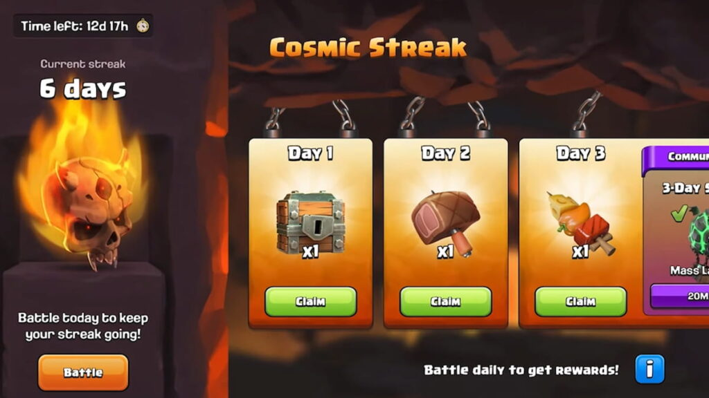

《部落冲突》Cosmic Streak 连续进攻活动于 **2026 年 10 月 16 日至 31 日**举行。每天完成进攻可以推进个人奖励，社区共同达成连续进攻目标后，还能解锁额外奖励。

## 每天如何推进

每天至少完成一次进攻，家乡与建筑大师基地均可。完成后前往活动界面领取对应奖励，连续参与即可继续推进奖励进度，漏打可能影响连续记录。

## 三档社区目标

- **连续 3 天**，需要 2000 万名玩家达成。奖励为 50 个 Lavaloon Injections，原文正文称为 Mass Lavaloon，安排在 10 月 21 日开放，持续 24 小时。
- **连续 5 天**，需要 1500 万名玩家达成。奖励为双倍胜利之星奖励，安排在 10 月 25 日开放，持续 7 天。
- **连续 7 天**，需要 1000 万名玩家达成。奖励为永久装饰 Violet Hot Streak。

这些奖励以社区达成相应目标为前提，原报道列出的是目标与奖励安排，未说明各档最终完成情况。

## 别错过领取时间

活动在 **10 月 31 日**结束，已解锁奖励可领取至 **11 月 1 日**。活动结束与领取截止并非同一天，记得在截止前收取奖励。

