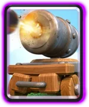
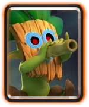
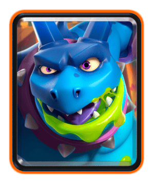
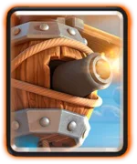
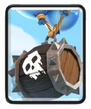

皇室战争 10 月赛季中最终平衡方案已确定，计划于 **10 月 19 日，周一**上线，具体维护时间尚未注明，国服是否同步也有待确认。

这轮调整重点压低迫击炮和法术诱饵体系的强度。**加农炮战车、吹箭哥布林、亡灵巨人和符文巨人**进入削弱名单，精英电法、雷电飞龙、飞行器和虚空法术获得加强。普通与觉醒骷髅气球将统一死亡伤害，骷髅兵则修正中置分路的一致性。

## 削弱卡牌

### 加农炮战车

| 调整项 | 调整前 | 调整后 |
| --- | --- | --- |
| 伤害 | 212 | 202（-5%） |
| 质量 | 3 | 6（+100%） |

调整说明指出，迫击炮卡组的防线往往过于难以突破，因此通过削减战车伤害来降低这类卡组的防守能力。

质量提高则是另一项机制变化。调整后，加农炮战车将不再被哥布林挤着移动。

### 吹箭哥布林

| 调整项 | 调整前 | 调整后 |
| --- | --- | --- |
| 伤害 | 151 | 143（-5%） |

吹箭哥布林出现在多套较强的法术诱饵卡组中，这次直接降低单次伤害，减少它持续输出时造成的压力。

### 亡灵巨人

| 调整项 | 调整前 | 调整后 |
| --- | --- | --- |
| 伤害 | 168 | 153（-9%） |

调整理由是亡灵巨人的快速施压能力仍然过强。这次继续削减单次攻击伤害，降低它接近防御塔后的进攻收益。

月初平衡已经放慢了亡灵巨人的攻击间隔，本轮又下调伤害，属于同一赛季内的进一步削弱。

### 符文巨人

| 调整项 | 调整前 | 调整后 |
| --- | --- | --- |
| 退场后附魔残留时间 | 5 秒 | 0.5 秒（-90%） |

符文巨人与亡灵巨人、小王子的搭配，是这次符文巨人调整重点针对的组合。此前符文巨人退场后，附魔仍能继续维持一段时间，队友可以继续享受增益。残留时间缩短后，这段额外收益将大幅减少。
## 增强卡牌

### 精英电法

| 调整项 | 调整前 | 调整后 |
| --- | --- | --- |
| 释放技能后的攻击延迟 | 存在延迟，未注明时长 | 移除 |

调整说明指出，精英电法的技能经常因为攻击延迟而未能发挥应有效果。这次取消技能后的等待，让他更及时地恢复攻击。

### 雷电飞龙

| 调整项 | 调整前 | 调整后 |
| --- | --- | --- |
| 首次攻击时间 | 0.7 秒 | 0.5 秒（-29%） |

雷电飞龙此前首击偏慢，防守时反应不够及时。这次缩短出手前的等待，也让对手在防守它时更难用其他单位及时转移其攻击目标。

### 飞行器

| 调整项 | 调整前 | 调整后 |
| --- | --- | --- |
| 伤害 | 171 | 179（+5%） |

飞行器与其他远程、空中卡牌竞争时表现偏弱，因此获得小幅伤害提升。

### 虚空法术

| 调整项 | 调整前 | 调整后 |
| --- | --- | --- |
| 2 至 4 目标档位单次伤害 | 296 | 307（+4%） |

按照本次调整说明，这一档伤害的一次命中将能消灭弓箭手和烟花炮手。

这里强调的是 2 至 4 目标档位的一次命中，不是所有目标数量下的伤害都一起提高。

## 重做卡牌

### 骷髅气球

| 调整项 | 调整前 | 调整后 |
| --- | --- | --- |
| 死亡伤害 | 145 | 163（+12%） |

普通骷髅气球在没有觉醒时相对偏弱，因此这次提高基础形态的死亡伤害，缩小它与觉醒形态的差距。

### 觉醒骷髅气球

| 调整项 | 调整前 | 调整后 |
| --- | --- | --- |
| 死亡伤害 | 192 | 163（-15%） |

觉醒形态的死亡伤害同步下调，觉醒与非觉醒两种形态的对应死亡伤害数值统一为 163。

### 骷髅兵

| 调整项 | 调整前 | 调整后 |
| --- | --- | --- |
| 出生分散距离 | 0.4 格 | 0.5 格（+25%） |

调整后，骷髅兵放在中间格子时将始终能够分路，不再受真假客场的的底层阵营判定影响，这项改动主要让同一摆位得到一致的分路结果。

以上就是本次赛季中调整的最终结果，基本来看小修小补比较多，应该是考虑在 CRL 总决赛前不做大的调整了。

那么，各位挑战者，你觉得这次调整如何？
