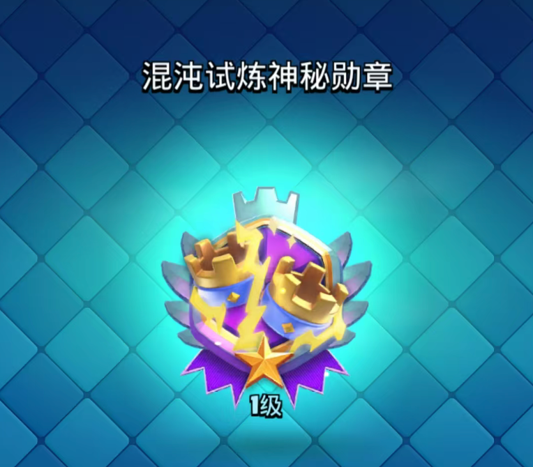
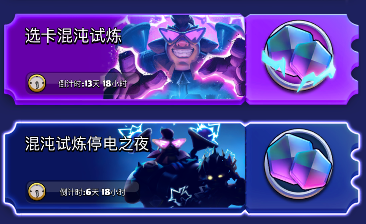
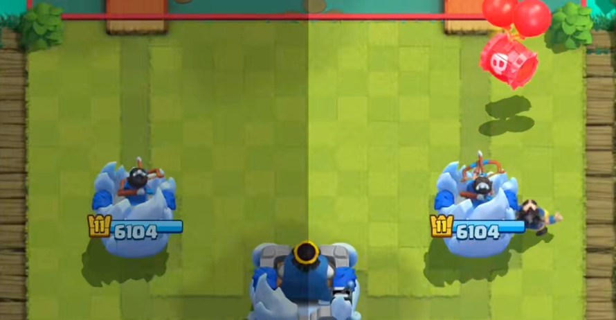
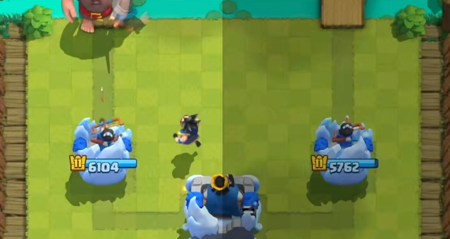

本赛季，皇室战争混沌模式又藏了一枚新徽章，名字叫“交流电”。

它最初由一位海外玩家意外获得，随后社区玩家不断尝试，才逐渐找出了获取方法。

这枚徽章的解锁方式也很符合它的名字。让电法在竞技场两侧交替登场，如同不断改变方向的交流电。具体操作需要记住两件事，**右左交替部署六次电法，以及赢下同一场比赛**。

## 在混沌模式中使用电法

首先这枚徽章需要在**混沌模式**的对战中获取，普通对战无法获取。

不管是选卡还是自备卡组，**保证你的卡组中有电法即可**。

任务使用的是**普通电法**，不需要额外满足混沌词条条件。电法吃到什么词条、有没有吃到词条，都不影响这套获取方法，选到他以后就可以开始准备。

## 右左交替，连续部署六次

对战开始后，以自己看到的竞技场左右两侧为准，第一次把电法放在右侧，第二次放到左侧，之后继续交替。

**右 → 左 → 右 → 左 → 右 → 左**

1. 第一次部署在竞技场右侧。
2. 第二次部署在竞技场左侧。
3. 第三次回到右侧。
4. 第四次放在左侧。
5. 第五次再放右侧。
6. 第六次放在左侧。

把“右、左”记成一轮，一共完成三轮，也就是下出六次电法。这里数的是电法的部署次数，**六次都要在同一场比赛中完成**，不能分到几场对局里累计。

实战中要一边应对对手，一边记住下一次该下在哪侧。可以每完成一次右左交替，就记一轮，比在紧张的对局里一直数到六更容易记清。前六次尽量严格按照顺序来，六次之后即使放错了顺序也不影响徽章的获取。

## 完成六次之后，还要赢下比赛

完成三轮交替部署后，任务还差最后一步，**赢得这场比赛**。只顾着循环电法、最后却输掉对局，仍然无法拿到徽章，所以部署顺序和正常攻防都要兼顾。

前六次完成之后，就不用继续为顺序分心了。已有成功对局中，玩家在三轮之后忘记了之前的顺序，后续没有保持右左交替，最终依然获得了徽章。

也就是说，**完成前三轮后，后续电法可以根据战况正常部署**。这时该在哪侧防守就在哪侧下牌，把比赛赢下来即可。

## 从左边开始行不行？

既然叫“交流电”，从左侧开始，再按左右交替部署，能不能解锁？

答案是肯定的，但是务必记住至少要至少交替部署一共六次电法。

## 目前已知问题

按照上述流程赢下比赛返回到主界面，有可能会给你一个之前的狼人徽章，还可能什么都没有。

但是，如果你确认你的流程没问题，你可以尝试杀死游戏进程然后重新进入游戏，然后就能正常弹出获得徽章的界面了。

