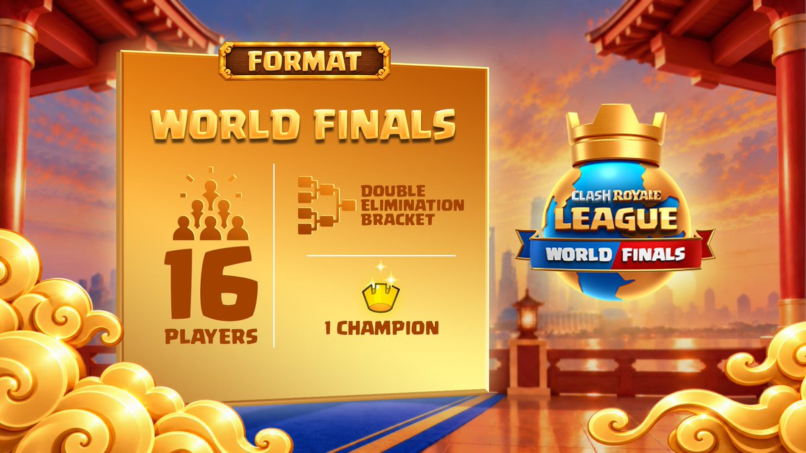
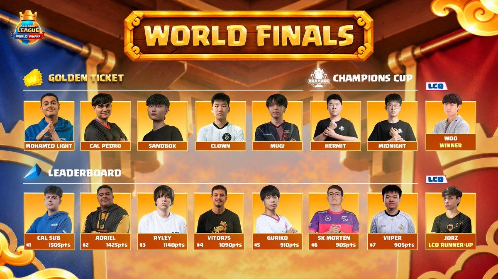
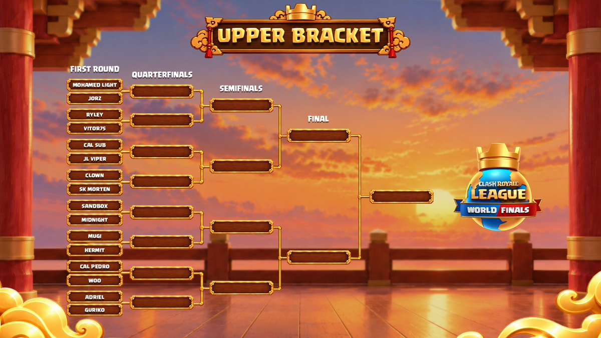
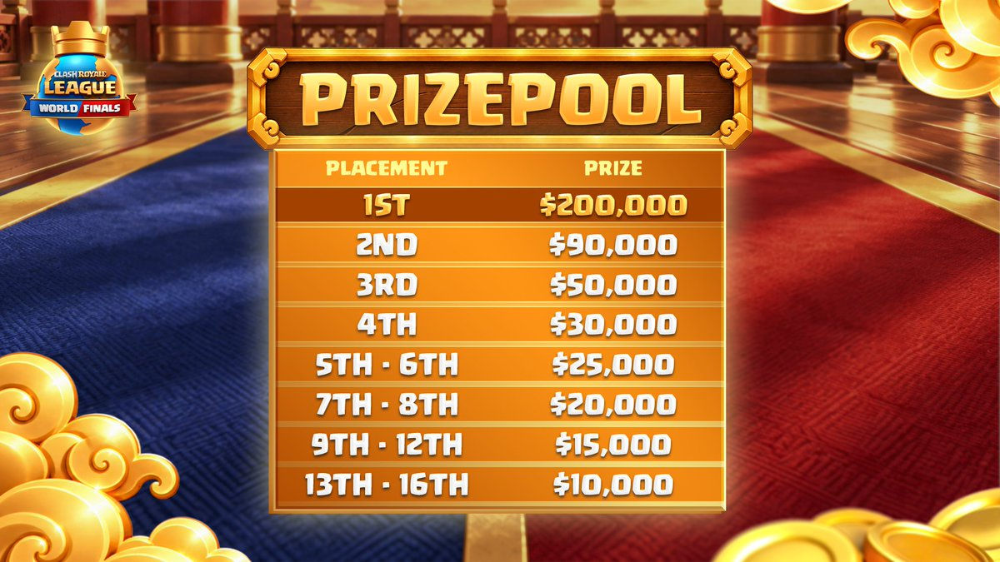
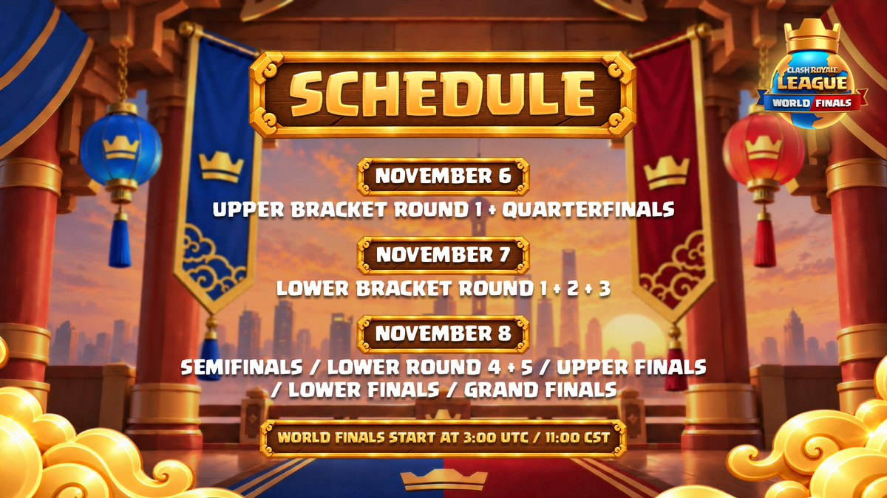
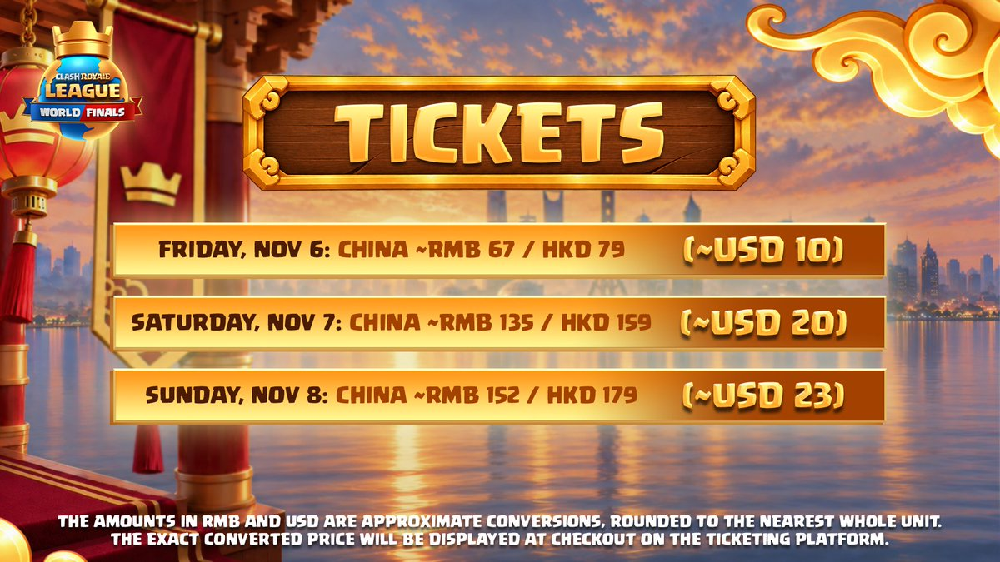

CRL 2026 全球总决赛将于 **11 月 6 日至 8 日**在中国上海举行，比赛地点为上海黄浦滨江文化中心（官方英文名称 Shanghai Huangpu Inner Bund Culture Center）。

16 位选手将争夺年度世界冠军。

## 赛制

本届全球总决赛沿用月度决赛的**双败淘汰赛制**。比赛前期采用 BO3，直至只剩三位选手。胜者组决赛、败者组决赛与总决赛采用 BO5。

完整规则可参阅[官方赛事规则书](https://docs.google.com/document/u/1/d/e/2PACX-1vQf4P255JMZrdvAdio3f2JS0kZoQyxglR32csP-tt_VODdL24yNU6Wf5CnFWSo4Tw/pub)。

## 16 位选手如何晋级

参赛资格来自四条路径。

- **月度决赛金券，共 5 人**，Mohamed Light、CAL Pedro、Sandbox、Clown、Mugi。
- **赛季积分榜，共 7 人**，CAL Sub、Adriel、Ryley、Vitor75、Guriko、SK Morten、Viiper。
- **中国冠军杯，共 2 人**，Hermit、Midnight。
- **最后机会资格赛，共 2 人**，Woo、Jorz。

官方另有[选手晋级历程介绍](https://x.com/EsportsRoyaleEN/status/2099508346499768485)，[Clash Royale Esports YouTube 频道](https://www.youtube.com/@EsportsRoyale)也提供 Juicy 对选手进行的一对一访谈。

## 首轮对阵

- Mohamed Light 对 Jorz。
- Ryley 对 Vitor75。
- CAL Sub 对 Viiper。
- Clown 对 SK Morten。
- Sandbox 对 Midnight。
- Mugi 对 Hermit。
- CAL Pedro 对 Woo。
- Adriel 对 Guriko。

## 奖金分配

官方公布的各名次奖金如下，币种均为美元，同一名次区间为每位选手所得。

| 名次 | 奖金 |
| --- | ---: |
| 冠军 | 200,000 美元 |
| 亚军 | 90,000 美元 |
| 季军 | 50,000 美元 |
| 第 4 名 | 30,000 美元 |
| 第 5 至 6 名 | 25,000 美元 |
| 第 7 至 8 名 | 20,000 美元 |
| 第 9 至 12 名 | 15,000 美元 |
| 第 13 至 16 名 | 10,000 美元 |

## 三天赛程

比赛三天均于**北京时间上午 11 时**开始，对应 UTC 03:00（这个时间安排很诡异，选手和观众都得饿着肚子）。

**11 月 6 日，首日共 12 场比赛**

进行胜者组首轮与胜者组四分之一决赛。

**11 月 7 日，第二日共 10 场比赛**

进行败者组第一轮、第二轮和第三轮。

**11 月 8 日，最后一日安排 8 场比赛**

进行胜者组半决赛、败者组第四轮和第五轮，随后是胜者组决赛、败者组决赛及总决赛。如有必要，还将进行总决赛重置赛。

## 现场门票

官方提供了 [UUTIX 购票入口](http://supr.cl/CRL26_Tickets)。各日票价在公告中列为以下金额。

- 11 月 6 日，79 港元，约合人民币 67 元或 10 美元。
- 11 月 7 日，159 港元，约合人民币 135 元或 20 美元。
- 11 月 8 日，179 港元，约合人民币 152 元或 23 美元。

国内购票渠道为游戏内购票，第一轮抢票已经结束，下周还有一次补票的机会，没抢到票的同学要记得关注官方消息。

人民币和美元数值为四舍五入后的参考换算价，准确金额以票务平台结账页面为准。

## 在哪里观看

无法到场的观众，可以通过[皇室战争官方赛事平台](https://event.supercell.com/clashroyale/en)观看直播，也可以选择自己关注的创作者转播。
