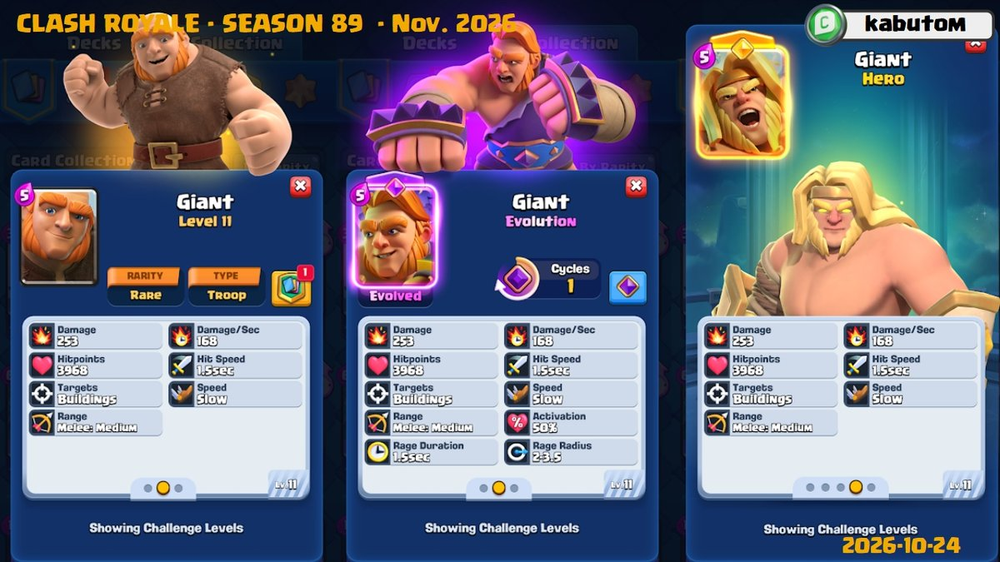
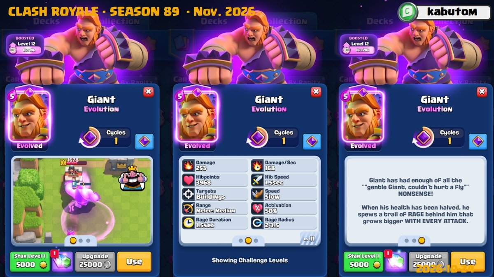
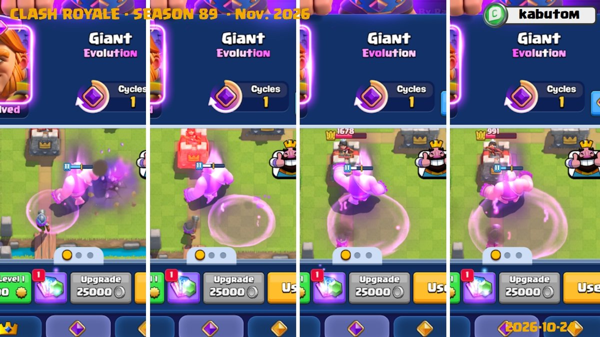
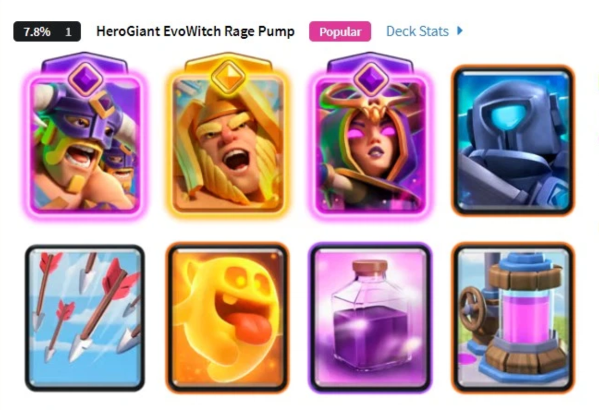
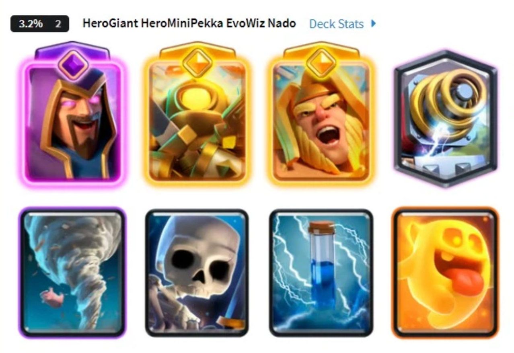
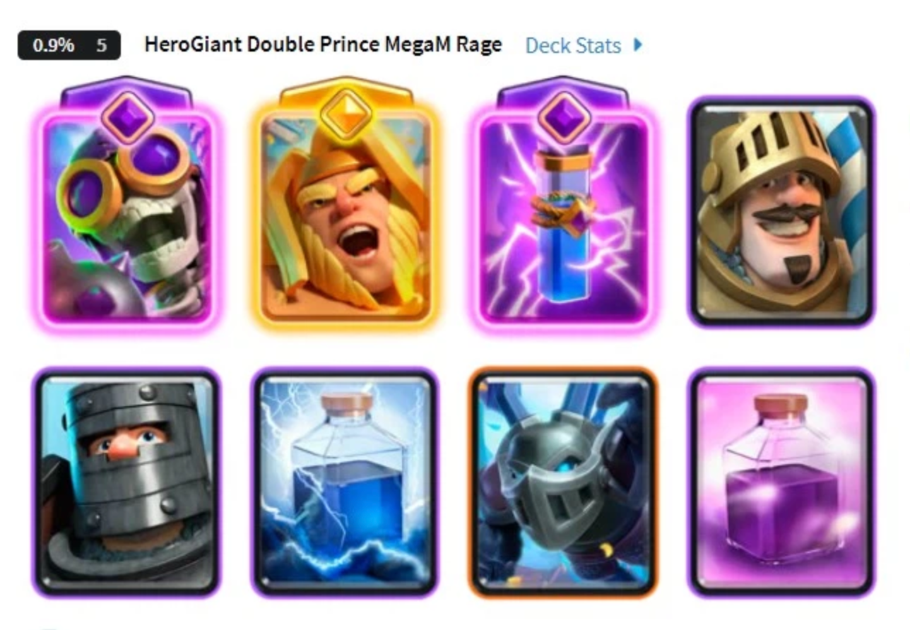
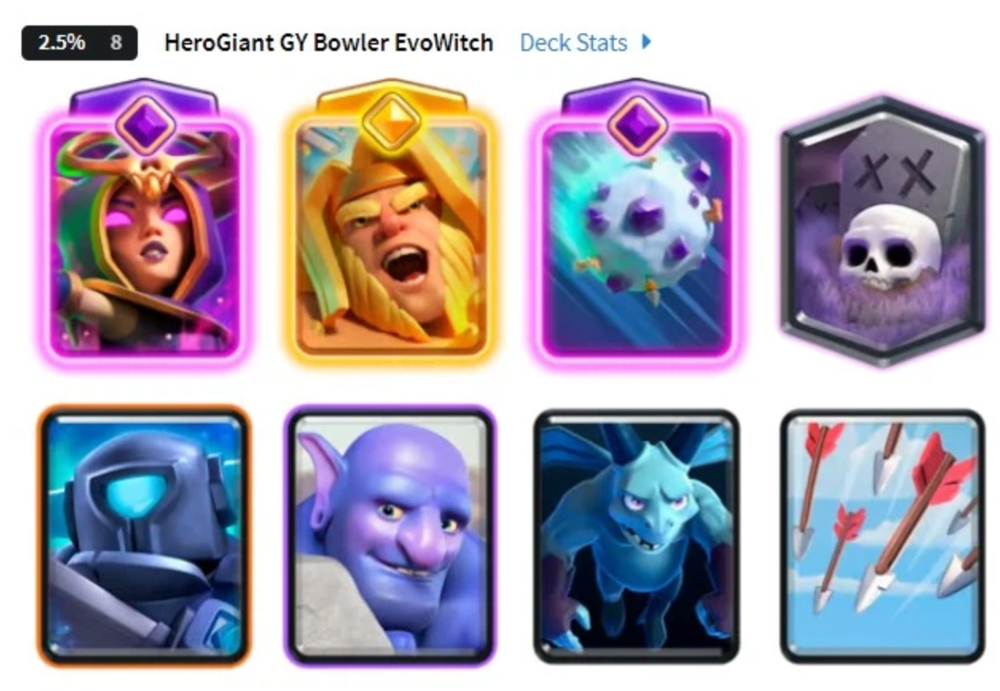
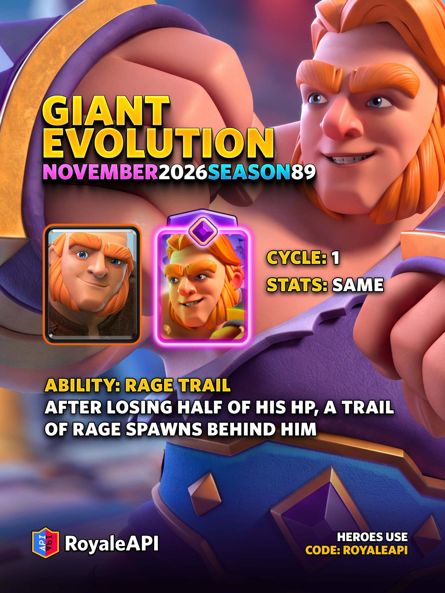

巨人将在 11 月赛季获得觉醒形态。

这一次，他依旧只攻击建筑，但生命值降到一半后，会不断在身后留下狂暴区域，让自己与附近友军一起加速。巨人每次出拳，还能进一步扩大狂暴范围，为身后的推进部队提供支援。

觉醒巨人计划于 **2026 年 11 月 2 日**上线。以下机制与数值来自先行测试版本，正式实装前仍可能调整。

## 5 费，一次循环，基础数值不变

觉醒巨人沿用普通巨人的圣水费用、攻击目标与基础面板。解锁觉醒不会直接增加生命值或单次攻击伤害，主要变化来自半血后的狂暴能力。

| 项目 | 先行版本数值 |
| --- | --- |
| 圣水费用 | 5 费 |
| 稀有度 | 稀有 |
| 攻击目标 | 建筑 |
| 觉醒循环 | 1 次 |
| 生命值 | 3968 |
| 单次伤害 | 253 |
| 每秒伤害 | 168 |
| 基础攻击间隔 | 1.5 秒 |
| 基础移动速度 | 慢 |
| 攻击距离 | 近战，中距离 |

以上战斗面板以 **11 级**为准，攻击间隔和移动速度为未获得狂暴时的状态。

1 次循环意味着，先打出一次普通巨人，下一次才是觉醒巨人。正常循环下，两次巨人部署中有一次能够以觉醒形态登场，不是开局第一张就直接觉醒。

## 半血后产生狂暴区域

当觉醒巨人的生命值降至 **50% 或以下**，他会开始周期性产生狂暴区域。区域位于身后，但范围也覆盖巨人自身，因此他能同时享受加速效果。

| 狂暴机制 | 数值或规则 |
| --- | --- |
| 触发条件 | 生命值不高于 50% |
| 区域生成间隔 | 1.5 秒 |
| 持续时间 | 1.5 秒 |
| 圆心位置 | 巨人朝向的后方 2.5 格 |
| 初始半径 | 2 格 |
| 最大半径 | 3.5 格 |
| 移动速度增幅 | 30% |
| 攻击速度增幅 | 30% |
| 区域伤害 | 0 |

这里要分清“狂暴区域持续时间”和“整段能力持续时间”。巨人触发能力后，每隔 1.5 秒生成一个持续 1.5 秒的区域，并非半血时只触发一次。

区域圆心始终位于巨人朝向的**后方 2.5 格**，会根据他面向的方向判断“身后”。即使圆的半径扩大，这个偏移距离也不会改变。巨人自身能够受益，与他的碰撞体积有关，不代表圆心就在脚下。

另外，这些区域**不会造成伤害**。它们能帮助友军更快移动、攻击，却不能像狂暴法术那样依靠伤害清掉附近的小单位。

## 范围靠攻击扩大，走路不会自动变大

狂暴区域的成长与攻击有关。能力刚触发、尚未开始攻击时，区域半径为 2 格；随后每次攻击会推进一档范围成长。

**2 格 → 2.5 格 → 3 格 → 3.5 格**

具体对应能力触发后攻击 0 次、1 次、2 次和 3 次及以上。**半血触发前打出的攻击不计入成长**，即使巨人此前已经连续攻击建筑，也不能在触发的一刻直接获得最大范围。

最大半径为 3.5 格。理解这一点后，就不能只按“巨人活得越久，圈就越大”来判断局面。他还需要真正打到建筑，才能推进范围成长。

对进攻方来说，巨人接触防御建筑后，同样有机会扩大身后的增益范围。对于防守方，也需要留意他开始攻击后的变化，不能只盯着巨人距离公主塔还有多远。

## 哪些友方目标能吃到狂暴

巨人的狂暴范围产生在其身后，而不是环绕自身，这应该是故意设计。

- 觉醒巨人自身。
- 范围内的友方部队。
- 范围内的友方建筑。
- 范围内的己方防御塔。

它的用途因此不限于桥头推进。在位置合适时，友方建筑与防御塔也能受到增益。不过，狂暴区域偏向巨人身后，不能把它理解成以巨人为中心、前后均匀覆盖的光环。安排后排时，要看单位是否真正处在区域内。

## 适合怎样的卡组

从机制看，觉醒巨人适合继续担任推进前排，搭配能够利用狂暴的后排输出。巨人负责承伤和接近建筑，身后的单位在区域内获得增益，两者的站位配合会直接影响能力收益。

脑测一下，下赛季可以一试的卡组包括，**胖子女巫、胖子电磁炮、双王胖和胖木**。

不过，胖墓还要多考虑一个位置问题。墓园主要在敌方塔周围生成骷髅，未必落在巨人身后的狂暴范围内。因此，采用这套组合时，不能默认墓园输出一定能吃到增益。

精英巨人和觉醒巨人也各有侧重。选择觉醒形态时，要为它安排觉醒槽位，并考虑后排能否利用狂暴；是否值得替换现有巨人配置，需要等上线后的实战环境来判断。

## 上线与获取方式

觉醒巨人将于 **11 月 2 日**随新赛季登场，付费皇室令牌的首个里程碑提供四选一奖励。

- 6 枚巨人觉醒碎片
- 200 枚精华币
- 7500 张普通外卡。
- 15 张传奇外卡。

想通过这一档奖励解锁觉醒巨人，需要选择碎片，四项奖励不能同时获得。也可以使用 6 枚万能觉醒碎片解锁。

解锁后，需要将巨人放入支持觉醒的槽位，才能在对战中完成循环并使用觉醒形态。

## 外观与动作也有更新

除狂暴能力外，觉醒巨人采用 3D 模型，攻击时会左右拳交替，并有用于最后一击的特殊动画。这些属于模型与动作表现，并无额外伤害或隐藏技能。
