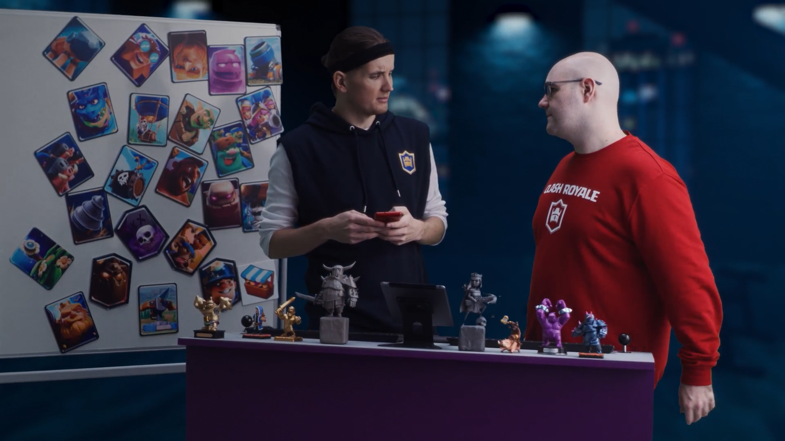
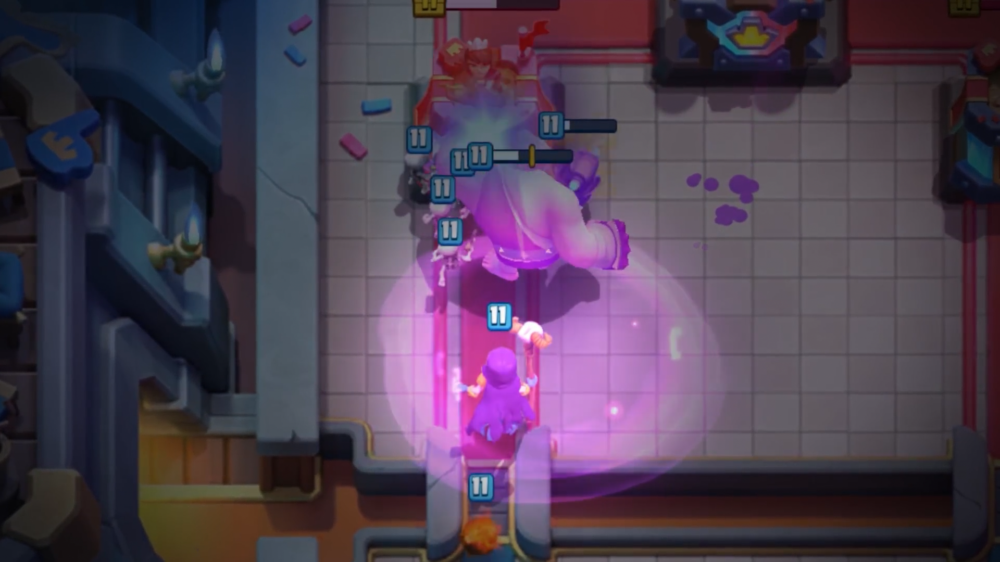
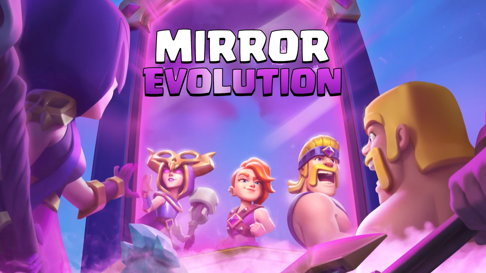
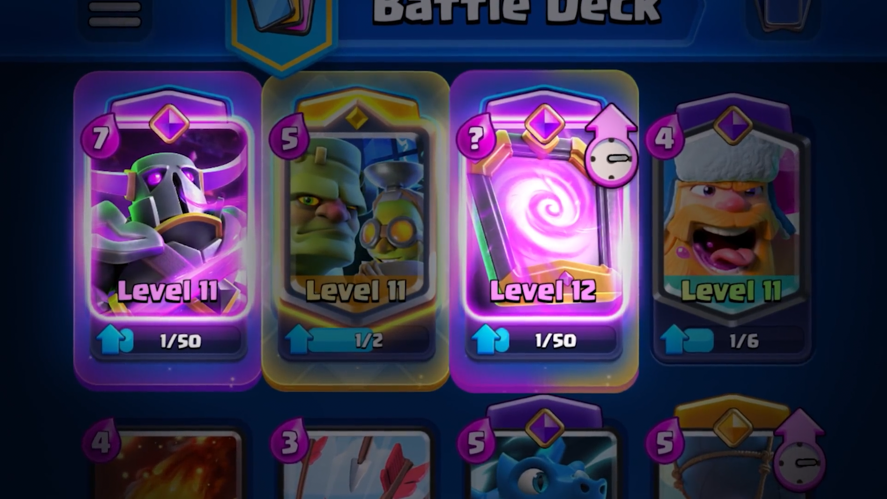
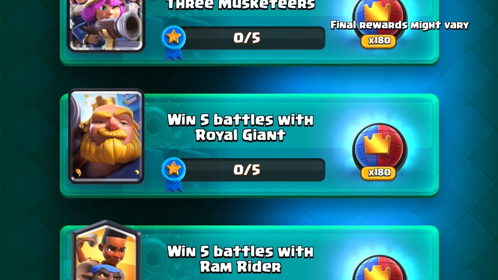
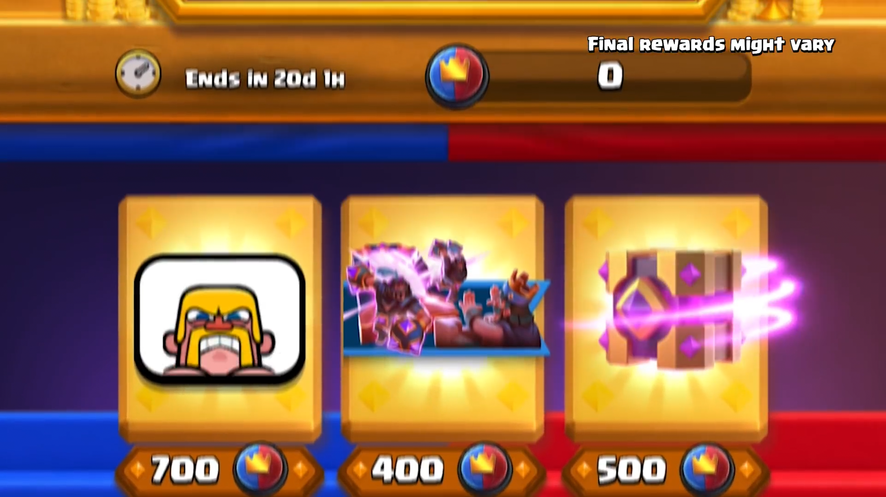
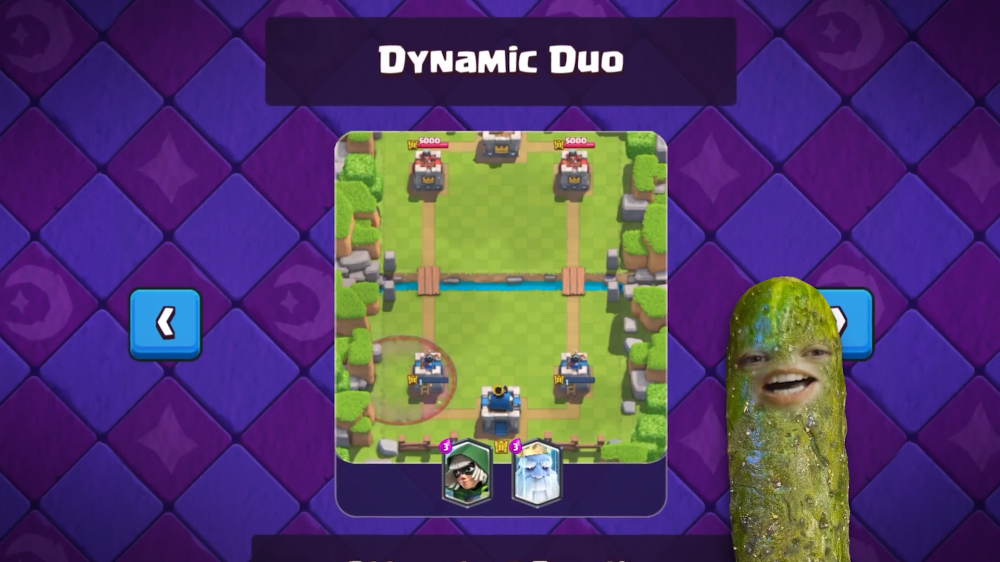
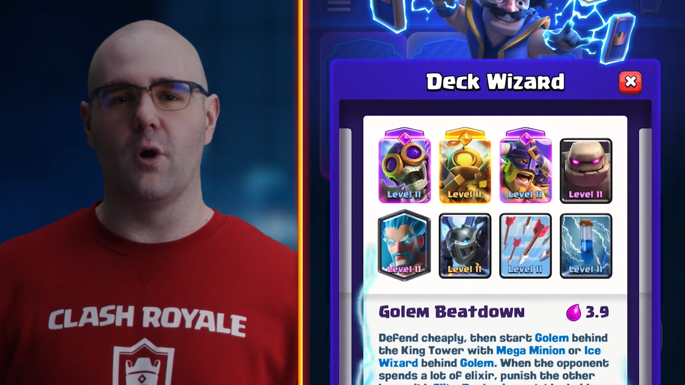
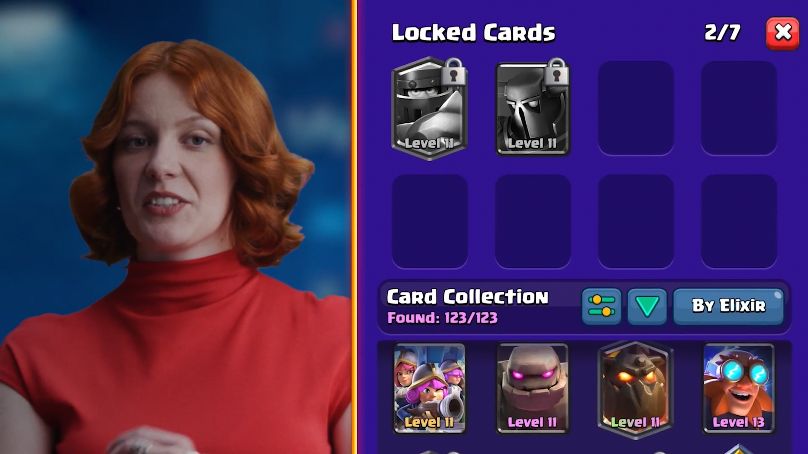

10 月皇室TV节目如期播出。

官方公布了 11 月赛季的主要内容，包括两张全新觉醒卡牌、回归的赛季商店、更新后的组卡器，以及一款将在总决赛现场公布的全新竞技模式。

## 01 觉醒巨人

觉醒巨人的基础机制与原版巨人一致，仍然只攻击建筑。变化出现在血量层面。当巨人受到足够多的伤害（爆料视频中显示为到第二段血条后）后，将进入狂暴状态。狂暴状态下，巨人的出拳速度大幅提升，并且左右拳交替攻击，对建筑的输出节奏明显加快。

狂暴机制还包含一个对团队作战影响更大的部分。巨人行进的路线会留下一条狂暴痕迹，身后的友军单位处于该范围内时，同样会获得狂暴效果。从爆料画面看，这片区域会随着巨人存活时间的延长而逐渐扩大。

从设计意图看，觉醒巨人的威胁与其存活时间直接挂钩。前排承伤时间越长，后排输出单位的增幅就越明显，整波推进的强度随之提升。实装后它很可能成为对局中需要优先处理的目标。

这么看来，精英巨人与觉醒巨人的取舍问题，需要等待实装后的实战数据才能判断。

## 02 觉醒镜像

原版镜像的效果为复制玩家上一张打出的卡牌，等级提高一档，费用增加一费。觉醒镜像保留了这套基础规则，改动集中在复制出的卡牌上，它会直接以觉醒形态登场。

有两个细节需要单独说明。

第一，觉醒镜像不受觉醒卡槽配置的影响。即使卡组中觉醒槽位安装的是其他卡牌，被镜像的卡牌依然会以觉醒形态登场。

第二，觉醒形态的解锁状态不影响效果。只要被复制的卡牌存在觉醒版本，复制体就直接是觉醒状态，与玩家是否解锁该卡的觉醒形态无关。

综合这两点，后续会出现一些此前不存在的场面。同一张卡牌的精英版本与觉醒版本可以同时在场，例如精英巨人与觉醒巨人同框登场。同一张卡牌的两个觉醒版本也可以同时出现。围绕镜像与双核心构筑的卡组，思路空间会明显扩大。

需要注意，不要将觉醒镜像用于没有觉醒形态的卡牌。这种情况下觉醒效果无效，只相当于多花一费复制一张普通卡牌。

至于巨人与镜像各需积累几轮觉醒进度，官方暂未公布，等待后续消息。

## 03 赛季商店回归，代币兑换奖励

11 月赛季的主线玩法围绕核心卡牌展开。官方将每周轮换一组核心卡牌的里程碑任务，例如使用巨人赢下五场对局，完成即可获得赛季代币。爆料画面中单档任务奖励为 180 代币，最终数值可能有调整。

代币用于在回归的赛季商店中兑换奖励。商店内包含动态塔皮肤与觉醒镜像，爆料画面显示觉醒镜像标价 1500 代币。此前需要长期投入的相册拼图任务，下个赛季不再推出，奖励获取路径整体切换为这套代币系统。

官方同步上线核心卡牌挑战，使用预设卡组即可参赛，同样可以完成里程碑任务获取代币。

## 04 解谜周

赛季期间将开启为期一周的解谜周活动，每天更新一道谜题。规则为双方手上最多四张牌，每张只能使用一次，对面的出牌顺序与落点每一局固定不变。玩家的目标是用最少的尝试次数完成破解。

尝试次数越少，奖励越好。这种固定答案的解谜玩法对卡牌位置与防守时机的理解有一定要求。

## 05 组卡器更新

游戏内置的组卡器此次获得实质性更新。它会基于玩家已拥有的卡牌自动生成多套卡组方案，其中包含多套经典卡组。

更新后的锁定功能实用价值较高。玩家可以先锁定希望保留的核心卡牌，组卡器围绕锁定的卡牌自动补齐其余位置。对于不熟悉卡组构筑的玩家，这项功能可以降低上手门槛。

## 06 总决赛公布全新模式

11 月 6 日开幕的 CRL 全球总决赛现场，官方将公布一种全新的竞技模式，并配有专属奖励。将重要更新安排在总决赛现场公布，通常意味着该模式属于比较重大的更新，具体情况等待官方揭晓。

