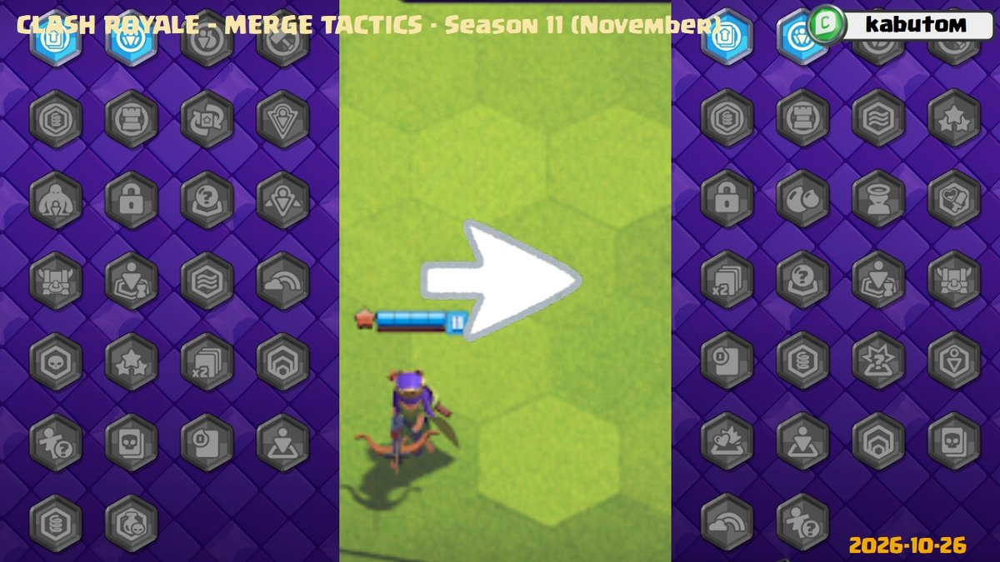

《皇室战争》合合奇兵第 11 赛季的十一月更新，计划于 **2026 年 10 月 27 日**上线。每回合获得的圣水将从 4 点恢复至 5 点，2 费与 3 费部队在共享卡池中的可用数量也会增加。

这次还会轮换超级部队与特殊规则，并调整统帅、首领特性和部分装备。更新内容仍可能在实装前变更，部分名称为暂译。

## 第 11 赛季继续，不进行月度重置

合合奇兵第 11 赛季持续三个月，时间为 **9 月 1 日至 12 月 1 日**。十一月更新属于同一赛季内的第三个月轮换，不是新赛季开始，也没有月度排名重置。

本月暂未公布新统帅或新皮肤。月度变化主要集中在卡池、任务奖励、特殊规则和战斗平衡。

## 每回合圣水与共享卡池调整

| 调整项 | 调整前 | 调整后 |
| --- | --- | --- |
| 每回合获得圣水 | 4 点 | 5 点 |
| 每种 2 费部队的共享卡池可用数量 | 4 | 8 |
| 每种 3 费部队的共享卡池可用数量 | 4 | 8 |

每回合多一点圣水，主要是为了改善前期推进偏慢的问题。超级部队进入共享卡池后，部分低费部队也更难合成，因此本次增加 2、3 费部队的可用数量，让玩家更容易追求三星与四星单位。

## 野猪骑士与黑暗王子回归

十一月卡池仍为 **29 张**，本次两进两出。

| 加入卡池 | 离开卡池 |
| --- | --- |
| 野猪骑士 | 皮卡 |
| 黑暗王子 | 武僧 |

超级野猪骑士与超级黑暗王子回归后，骑乘特性重新加入。结合留在卡池中的超级迷你皮卡与超级骑士，本月的超级部队由两位首领和两位骑乘单位组成。

## 统帅任务法球

本次主要改变任务一和任务二的法球，任务三保持原样。

| 法球 | 圣水或队伍奖励 | 其他奖励 |
| --- | --- | --- |
| 任务一 | 3 点圣水 | 随机装备或一个 2 费二星单位 |
| 任务二 | 6 点圣水 | 随机装备或一个 3 费二星单位 |
| 任务三 | 队伍规模加 1 | 一个 4 费或 5 费三星单位 |

任务一的装备范围包括少女之盾、王子长枪、渔夫钩、女武神战斧、狂暴樵夫酒瓶、战斗天使祝福、皮卡之剑与弓箭女皇披风。

任务二涉及刺客之刃、重装铠甲、射手弩、巨星戒指、控制魔法、龙鳞、法师魔杖、投掷者望远镜、亡灵战鼓、哥布林鲁特琴、首领面具、骑乘徽记、传奇战斧与传奇护盾等装备。

**传奇长枪将从任务二法球中移除**，为其他装备留出更多出场机会。

## 十一月特殊规则

特殊规则总数维持 26 个，随联赛阶段解锁并进行月度轮换。圣水盛宴、伤害地块等规则将在本月回归，具体安排如下。

| 联赛 | 特殊规则 |
| --- | --- |
| 青铜 I | 合并训练、特性训练 |
| 青铜 II | 交易训练、装备训练 |
| 青铜 III | 地块训练、建筑训练 |
| 白银 I | 皇家河流、觉醒 |
| 白银 II | 迷你合并、圣水盛宴（回归） |
| 白银 III | 断舍离之力（回归）、伤害地块（回归） |
| 白银 IV | 四星、法球盛宴 |
| 黄金 I | 大逃杀、哥布林宝藏 |
| 黄金 II | 首次免费、跳跃地块 |
| 黄金 III | 晋升（回归）、隐身地块（回归） |
| 黄金 IV | 指导（回归）、回声替补席 |
| 黄金 V | 虫洞地块、归我了 |
| 钻石 | 特性赠礼、特性假人 |

## 统帅平衡调整

### 大守护者

| 调整项 | 调整前 | 调整后 |
| --- | --- | --- |
| 星盾触发概率 | 10% | 7% |
| 熔岩盾、狂暴盾、减速盾的各自触发概率 | 30% | 31% |
| 护盾破裂效果半径 | 3 格 | 2 格 |

星盾的出现频率降低，护盾破裂的影响范围缩小，其他三类护盾的概率则各提高 1 个百分点。

### 墓碑女王（Tomb Queen）

| 调整项 | 调整前 | 调整后 |
| --- | --- | --- |
| 每召唤一个骷髅的间隔 | 4 秒 | 3 秒 |

召唤速度加快，以改善前期表现，并帮助她推进统帅任务。

### 战争机器

| 调整项 | 调整前 | 调整后 |
| --- | --- | --- |
| 每颗星提供的建筑生命值增幅 | 2% | 1.5% |
| X 连弩攻击间隔 | 0.3 秒 | 0.5 秒 |

建筑的后期耐久与 X 连弩输出一并降低，减少单个建筑在后期决定战局的情况。

### 飞刀女爵

| 调整项 | 调整前 | 调整后 |
| --- | --- | --- |
| 统帅任务要求的回合获胜时限 | 8 秒 | 9 秒 |

完成任务的时间窗口延长 1 秒。

## 部队平衡调整

### 超级黑暗王子

| 调整项 | 调整前 | 调整后 |
| --- | --- | --- |
| 伤害 | 100 | 75 |

### 超级骑士

| 调整项 | 调整前 | 调整后 |
| --- | --- | --- |
| 伤害 | 100 | 50 |

击退与眩晕能力保留，伤害下调，降低其控制之外的输出压力。

### 超级迷你皮卡

| 调整项 | 调整前 | 调整后 |
| --- | --- | --- |
| 每回合提供的煎饼数量 | 可提供多份 | 最多 1 份 |

减少同一回合内连续提升友军等级的情况。

### 弓箭女皇

| 调整项 | 调整前 | 调整后 |
| --- | --- | --- |
| 攻击间隔 | 1.43 秒 | 1.67 秒 |

攻击节奏放慢，技能的触发节奏也会受到影响。

## 特性平衡调整

### 超级首领

以下斜杠分隔数值按特性由低至高的四档排列。

| 调整项 | 调整前 | 调整后 |
| --- | --- | --- |
| 生命值加成 | 25%／50%／100%／300% | 15%／30%／80%／200% |
| 恐惧范围 | 2／3／4／5 格 | 所有档位均为 1 格 |
| 恐惧持续时间 | 所有档位均为 3 秒 | 0.5／1／2／3 秒 |

首领的生命值优势和恐惧覆盖范围均被压低，低档特性的恐惧时间也明显缩短。

### 亡灵

| 调整项 | 调整前 | 调整后 |
| --- | --- | --- |
| 每有友军被击败时获得的生命值与伤害加成 | 1%／2%／4% | 1%／3%／5% |

第一档不变，第二、第三档增强。

## 装备调整

### 巨星戒指

| 调整项 | 调整前 | 调整后 |
| --- | --- | --- |
| 技能再次触发 | 50% 概率，最多 4 次 | 移除随机重复触发 |
| 新触发限制 | 原有机制 | 战斗开始时触发，每回合仅 1 次 |

调整后不再依靠概率让技能反复发动。

## 问题修复

- 哥布林牢笼被法师魔杖变成无害兔子后，不再发动捕获。
- 两个哥布林牢笼互相拉拽时，不再出现素材消失。
- 从哥布林牢笼释放的骑乘单位，不再受到意外伤害。
- 修正黑暗王子的跳跃持续时间，以及目标被牢笼拉走后仍锁定目标、攻击已被击败敌人的问题。
- 骑士的嘲讽不再使骷髅巨人和炸弹哥布林的死亡爆炸失效。
- 地狱之塔攻击圣水收集器时，不再出现回血。
- “归我了”（You Are Mine）规则下，哥布林牢笼被摧毁时会正确发放法球。

