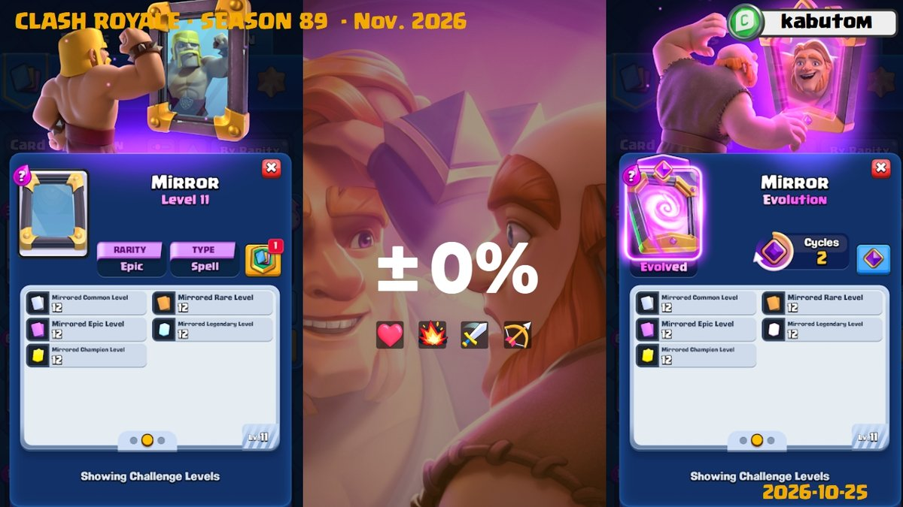
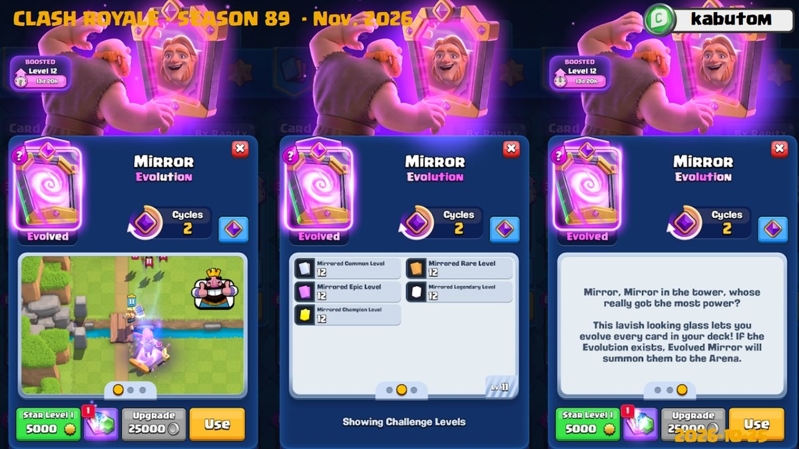
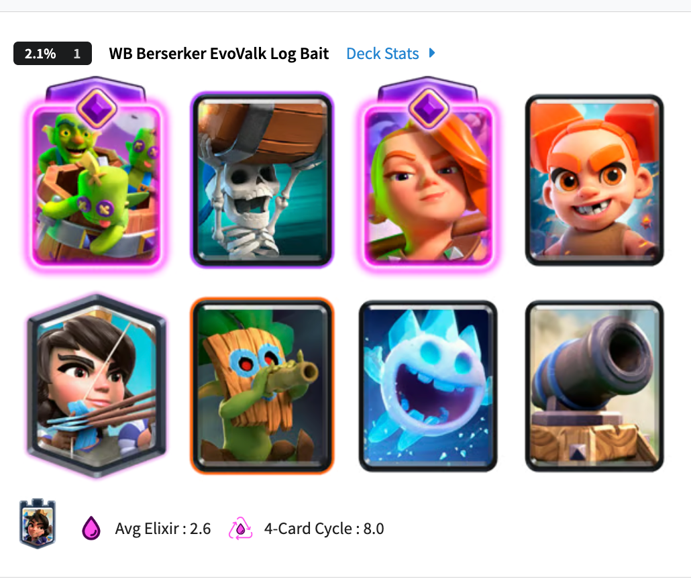
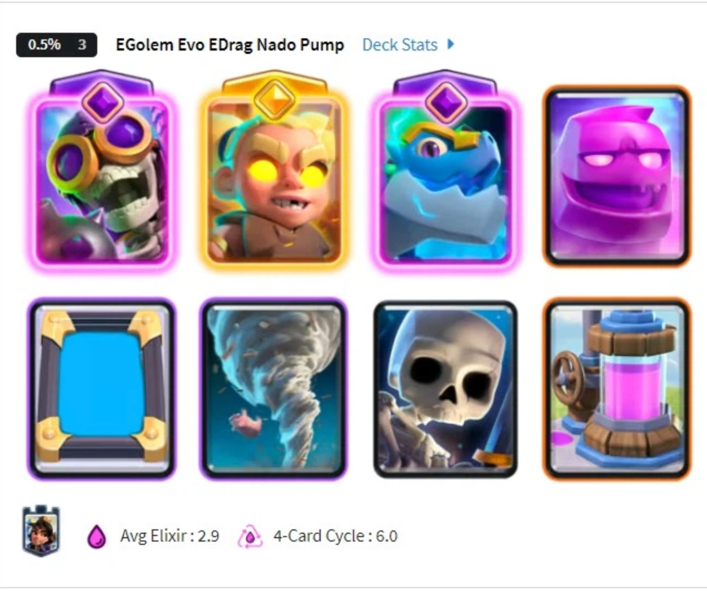
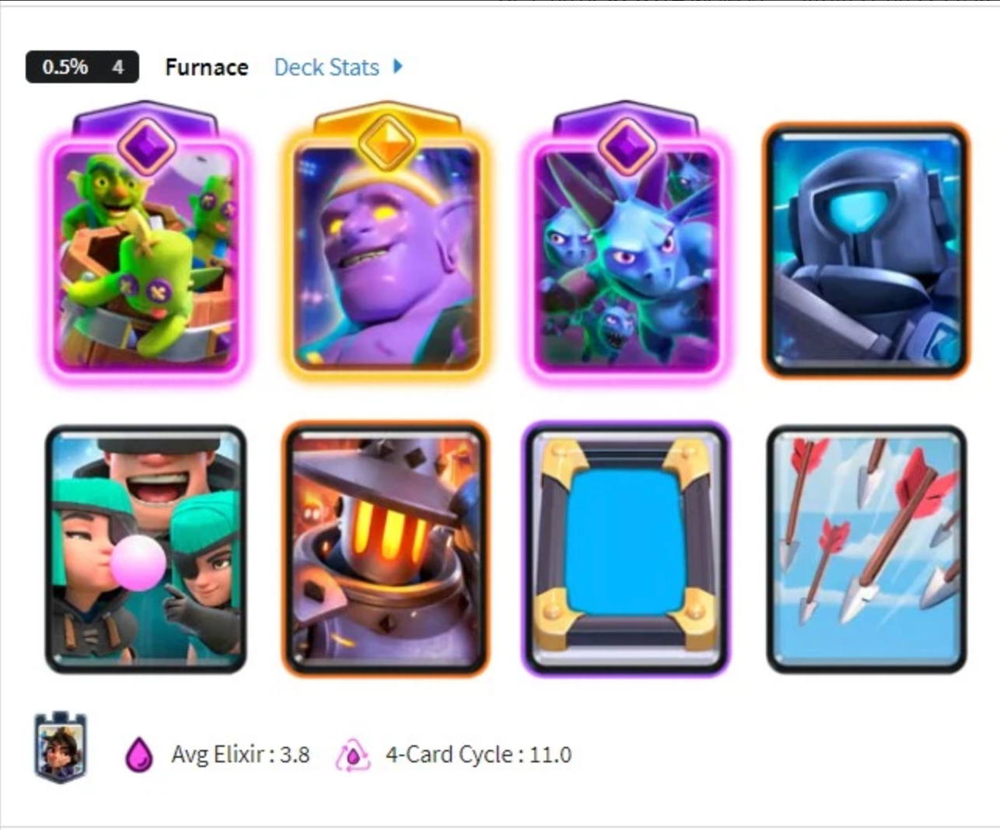

镜像卡牌是 11 月的另一张觉醒卡牌。

觉醒镜像带来的变化很特别。轮到觉醒回合时，它能直接复制出卡牌的觉醒形态，而且目标卡牌不必放在觉醒槽位，也不要求玩家提前解锁它的觉醒。

这让卡组里的普通卡牌也有机会突然以觉醒形态登场。不过，要用出这次复制，需要先使用两次普通镜像，还要把觉醒回合留给合适的目标。想得到收益，出牌顺序比普通镜像更需要提前安排。

觉醒镜像计划于 **2026 年 11 月 2 日**随新赛季一起上线。

## 两次循环，第三次镜像才觉醒

觉醒镜像的循环次数为 **2**。正常对局中，先使用两次普通镜像，第三次使用镜像时才会触发觉醒效果。

| 项目   | 先行版本规则            |
| ---- | ----------------- |
| 类型   | 法术                |
| 稀有度  | 史诗                |
| 圣水费用 | 被复制卡牌的费用加 1       |
| 觉醒循环 | 2 次               |
| 复制等级 | 保留普通镜像的等级加 1 规则   |
| 觉醒效果 | 目标已有觉醒版本时，召唤其觉醒形态 |

循环次数固定为 2，不会因为复制的是高费卡牌就缩短为 1。先用低费牌完成镜像循环，之后再复制关键觉醒卡，是可以考虑的操作方向，但每次镜像仍要多支付一费。

觉醒也没有像提前泄露的一样，将复制等级改成加 2。

## 不受目标卡牌槽位限制

普通镜像即使复制的是一张觉醒卡牌，复制体也只会是普通形态。觉醒镜像在自己的觉醒回合，可以直接让复制体以觉醒形态登场。

目标卡牌放在觉醒槽位时可以复制，放在普通槽位也可以。对于同时拥有精英与觉醒形态的卡牌，即使原卡使用的是精英槽位，觉醒镜像依然可以复制出其觉醒版本。

因此，同一张卡牌的两个觉醒单位可以同时在场，精英版本与觉醒版本也有机会同场出现。组卡时，除了已有的觉醒槽位，还需要考虑其他位置上的卡牌能否成为镜像的目标。

## 没解锁目标的觉醒，也能复制

这里要区分两种情况。**卡牌已有觉醒版本，但玩家没有解锁**，不影响觉醒镜像生效；**卡牌根本没有觉醒版本**，就无法得到觉醒复制体。

前一种情况下，只要玩家能够使用该卡牌，觉醒镜像就能复制出它的觉醒形态。这也提供了一种试用思路，在投入万能觉醒碎片解锁觉醒卡牌之前，先通过觉醒镜像体验目标觉醒的能力。

后一种情况下，觉醒镜像只能按普通镜像的规则复制，保留费用加 1 和等级加 1 的效果。本次觉醒机会不会因为没有可用形态就替你保留，所以第三次镜像前，要先确认上一张打出的牌是不是原本想复制的目标。

## 循环成本与出牌顺序是主要限制

镜像的费用随复制对象变化，复制低费牌可以较快推进循环，但额外费用始终存在。为了尽早拿到觉醒，连续使用收益不高的普通镜像，可能让前半段对局更难处理。

它还不会出现在开局的前四张手牌中。加上需要两次循环，一局至少使用三次镜像，才能得到第一次觉醒复制；想触发第二次，则需要使用到第六次。

镜像本身也会暴露后续的出牌可能。对手看到你连续复制同类单位后，往往会开始保留对应解牌。觉醒回合能否形成压力，取决于对手手里还有什么，以及你愿意为这次进攻投入多少圣水。

## 可以尝试哪些组卡方向

首先武神的桶子应该很不错。一是循环够快，二是已经觉醒的卡牌足够多。你可以借助镜像连续打出需要相似解牌处理的单位，争取让对手的法术跟不上。例如哥布林飞桶与骨球，吹箭，都可以作为觉醒复制的候选目标。防守的时候还可以考虑镜像好武神和土炮待命。

另一个方向是配合水罐子。普通镜像阶段可考虑复制收集器，为后续投入争取费用；卡组再搭配低费牌，加快镜像循环。不过，这类配置仍需要承担前期防守压力，不能把收集器视为免费补足额外费用的办法。

锅炉相关卡组也不错，+1 等级的锅炉是可以豆子蹭塔的。

总之，下赛季可以遇见的是，会有各种奇思妙想的乐子卡组出现，当然，局面估计也会很混乱。

## 上线与获取

觉醒镜像计划在 **11 月 2 日**随新赛季上线，并通过 11 月的新活动提供免费获取机会。也可以收集对应觉醒碎片，或使用 6 枚万能觉醒碎片解锁。

