《皇室战争》十一月第 89 赛季「国王对决」将于 **11 月 2 日开启，12 月 7 日结束**，持续五周。红蓝两位国王成为本季主角，围绕核心卡展开的活动、皇家市场和每日谜题将陆续登场，11 月 6 日至 8 日还将迎来上海 CRL 全球总决赛。

两张新觉醒分别为巨人与镜像。巨人进入皇室令牌，镜像从赛季第二周进入市场获取渠道，两者也支持使用万能觉醒碎片解锁。

新赛季的外观内容包括 **13 款表情、18 套战旗和 2 款塔皮**，获取渠道涵盖令牌、活动、商店与赛事。部分内容尚未确定开放方式，不代表全部免费或都会在本月发放。

## 觉醒巨人

胖子基础属性不变依然是对塔核心，前半段和普通巨人没区别，适合放在推进的最前面吃伤害。

觉醒之后，胖子生命值降至 50% 或以下时，会在身后产生狂暴区域。能力触发后的每次攻击会逐步扩大区域，半径从 2 格增加至最多 3.5 格。

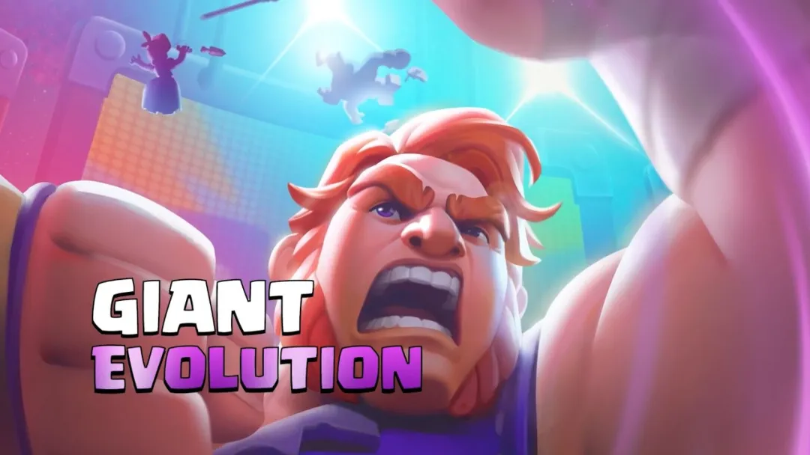

胖子自身与范围内的友军都能获得狂暴增益，单次基础伤害没有增加，但攻击节奏加快。范围成长依赖攻击次数，单纯延长行走时间不会自动扩大区域。

巨人需要 1 次觉醒循环，获取方式为皇室令牌的巨人觉醒碎片选项，或使用 6 枚万能觉醒碎片。详细机制可查看：[觉醒巨人介绍](/posts/clashroyale/2026-10-24/giant-evolution-guide/index)。

## 觉醒镜像

普通镜像复制你上一张打出的卡，等级加一。进化镜像是这个效果再加一层，复制出来的东西直接是进化形态。

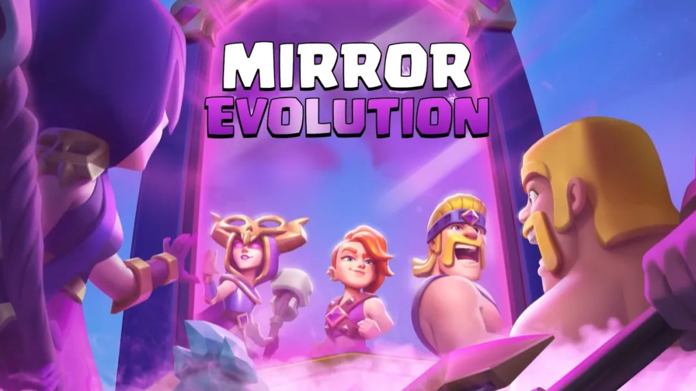

被复制的卡牌必须已有觉醒形态，但不需要占用觉醒槽，也**不要求玩家提前解锁该觉醒**。如果目标尚无觉醒版本，复制结果就与普通镜像相同，保留原有等级加成。

镜像需要 2 次觉醒循环，正常情况下第三次使用镜像才会触发觉醒效果，费用仍比复制对象多 1 点圣水。是否适合加入卡组，还要结合循环成本和复制目标判断。

第二周进商店，也能用万能碎片换。

更多详细的机制可查看 ：[觉醒镜像介绍](/posts/clashroyale/2026-10-26/mirror-evolution-guide/index)。

## 卡牌之王

整个赛季的主线活动叫卡牌之王，11 月 9 日开始，12 月 7 日结束。巨人和镜像从赛季第一天就一直处于强化状态，其余核心卡按周轮换。

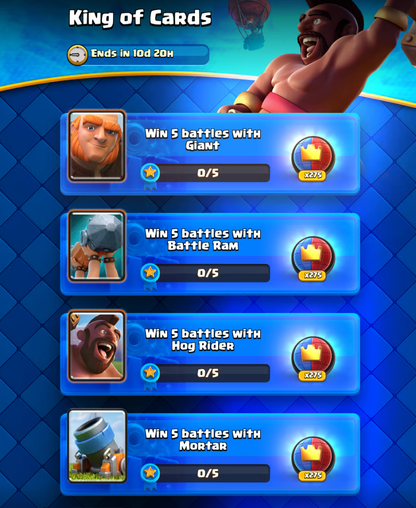

| 时间 | 强化核心卡 |
| --- | --- |
| 11 月 2 日 - 12 月 7 日 | 巨人、镜像（整季） |
| 11 月 9 日 - 16 日 | 野蛮人攻城槌、野猪骑士、迫击炮、亡灵巨人、哥布林飞桶 |
| 11 月 16 日 - 23 日 | 气球、皇家野猪、三个火枪手、皇家巨人、蛮羊骑士、工程炸弹人 |
| 11 月 23 日 - 30 日 | 哥布林巨人、骷髅飞桶、戈仑石人、雷胖、熔岩猎犬、圣水戈仑 |
| 11 月 30 日 - 12 月 7 日 | X 连弩、掘地矿工、骷髅召唤、哥布林钻机 |

配套三场挑战提供预设卡组，方便体验不同核心卡，也可以按需要调整构筑。

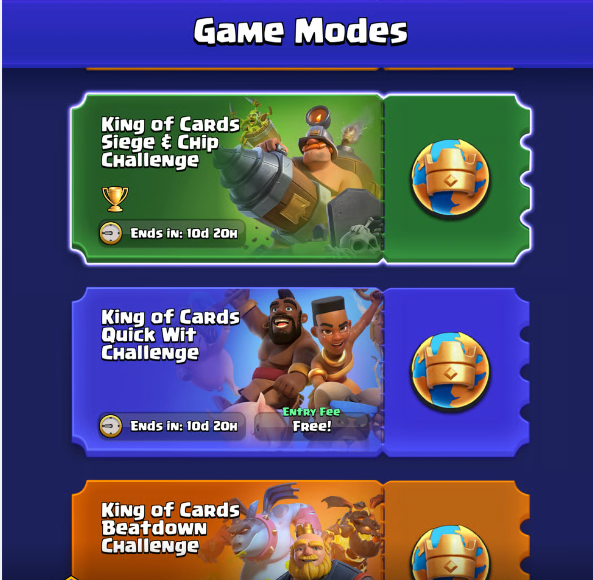

| 挑战 | 时间 |
| --- | --- |
| 机智挑战（Quick Wit） | 11 月 16 日 - 23 日 |
| 强攻挑战（Beatdown） | 11 月 23 日 - 30 日 |
| 攻城消耗挑战（Siege & Chip） | 11 月 30 日 - 12 月 7 日 |

活动期间打赢核心卡对战会给王冠代币，代币可在回归的赛季商店兑换个奖励。同时，完成整条主线活动，还有一枚核心卡精通的限定徽章。

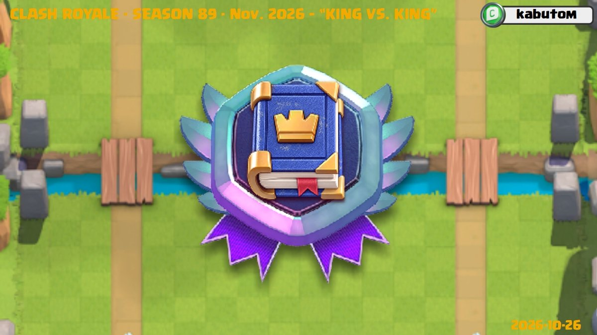

## 每日谜题

11 月 2 日到 8 日，每天一个残局。系统给你一副 1 到 4 张卡的牌，每张卡只能打一次，对手的出牌位置和时机每次都一模一样。你要用这套固定的牌打赢对面，比的是谁用的次数少。

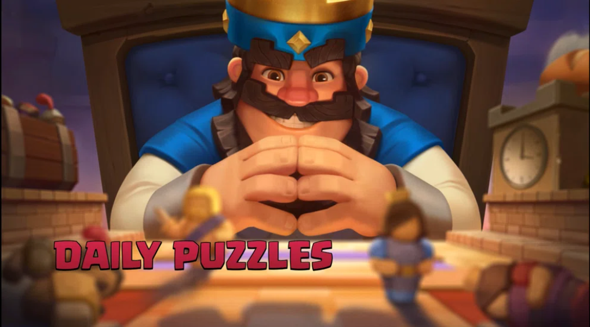

这项玩法侧重解题与比较尝试次数，没有公布按尝试次数分档发奖的规则。每次尝试中，对手的卡牌、位置和出牌时机都相同，可以据此反复调整解法。谜题名称也值得留意。

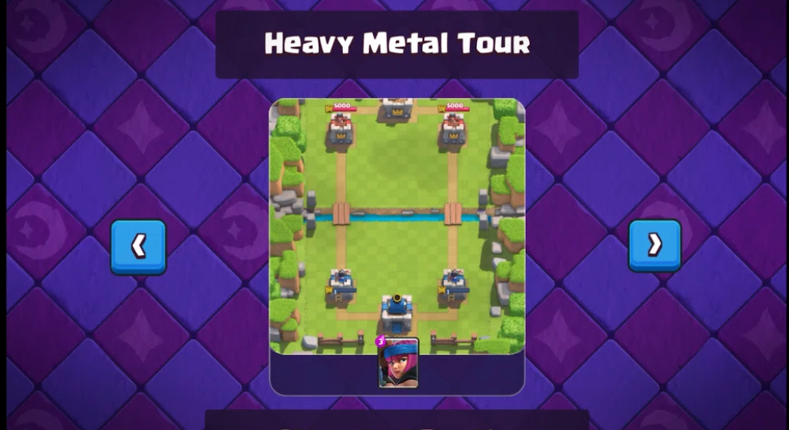

赛季末 11 月 30 日到 12 月 7 日还有第二批谜题。

## 赛季商店

下赛季，赛季商店将会回归，从11 月 9 日开到 12 月 7 日，活动中获取的代币可在赛季商店中兑换个奖励。3000 代币可解锁最贵档次的奖励，包括进化镜像碎片和一款**动态塔皮**。

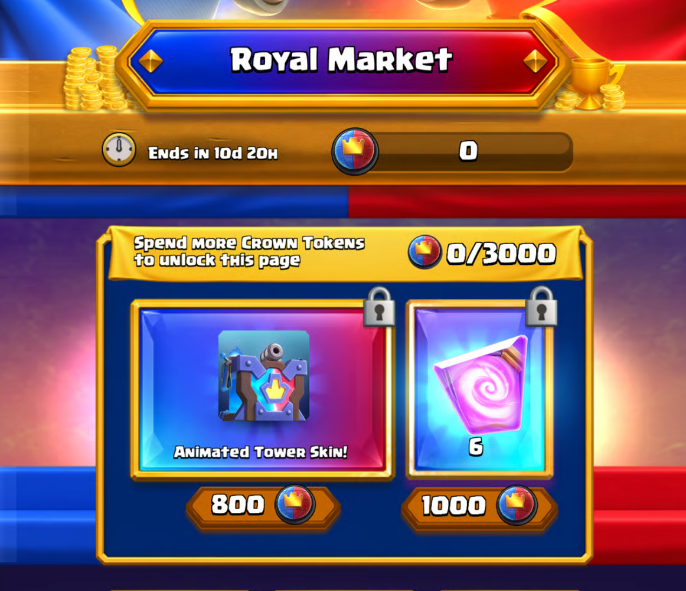

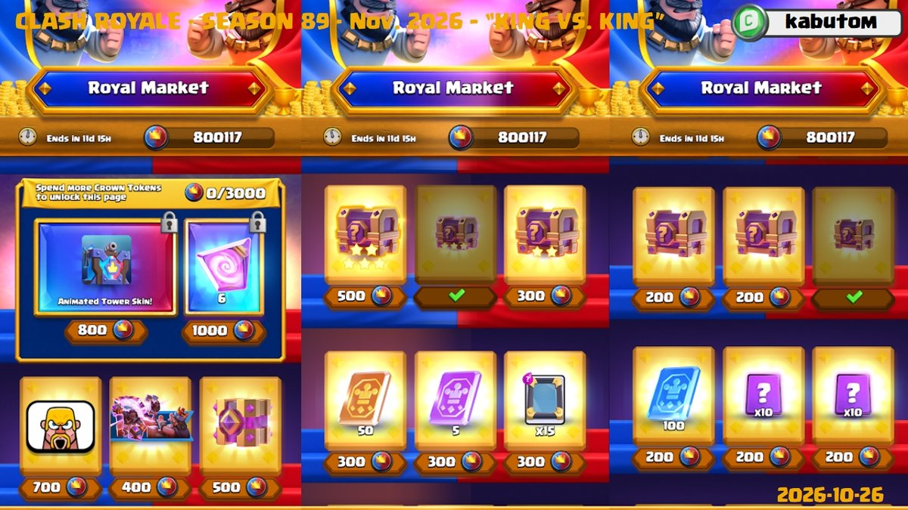

其他已知的奖励包括：6 枚镜像觉醒碎片标价 1000 代币，塔皮为 800 代币，野蛮人表情为 700 代币。最终价格、活动可获得的代币数量及兑换次数，以正式开放后的界面为准。

## 卡组向导

下赛季新的游戏内置组卡器也会上线。

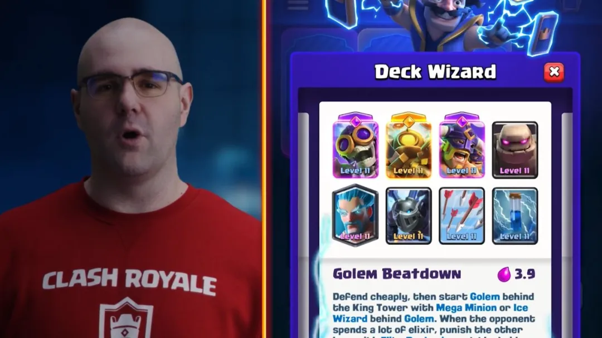

赛季第二周上线，位置在奖杯之路的卡组编辑页。可以完全从零组一套，也可以先锁定几张想用的卡牌，让组卡器围绕着这几张卡牌进行补充。决斗卡组里，它只会推荐你还没放进其它卡组的卡。

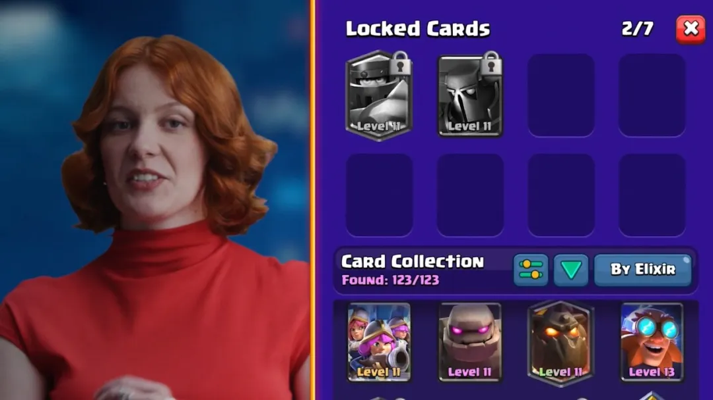

卡组向导计划在 **11 月 9 日所在周**开始分批测试，未看到入口的玩家需要等待后续开放，并非全体玩家在同一天上线。

## 新竞技玩法

全新竞技内容将在 **11 月 6 日至 8 日**的全球总决赛直播期间公开，具体玩法尚待揭晓。

新内容名为 Crown Series，其中还包含几款全新的战旗。具体赛制、参加方式和奖励条件仍待公布。

不过既然是放在总决赛这么重要的直播现场公开，应该会是不小的更新，可以小期待一下了。

## 全新塔皮

**Top Tier** 来自钻石皇室令牌，以金色奖杯与桂冠为主要造型。

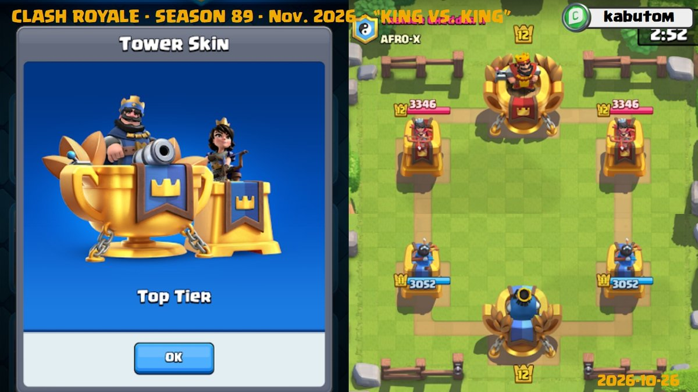

**Crowning Competitor** 来自皇家市场，是本季动态塔皮。红蓝装甲与发光结构对应赛季竞技主题，需要先满足高档商品解锁条件，再支付代币兑换。正式中文名以游戏内为准。

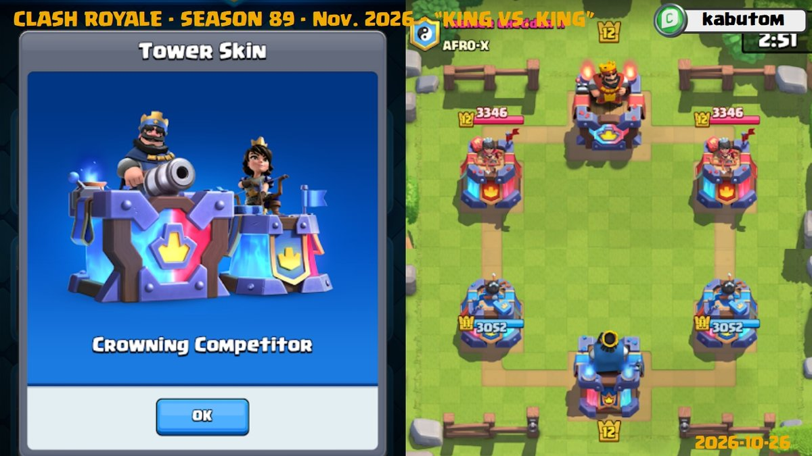

## 战旗 18 套

| 系列 | 数量 | 获取 |
| --- | --- | --- |
| 冲突之书 1 至 4 | 4 | 活动 |
| 全民竞技 及前三名 | 4 | 皇冠系列、通行证 |
| 进化镜像 | 1 | 赛季商店 |
| 亲吻奖杯（Kiss the Cup） | 1 | TV Royale |
| 其余八款 | 8 | 待公布 |

每套战旗由边框和装饰组成，18 套合计为 36 件。

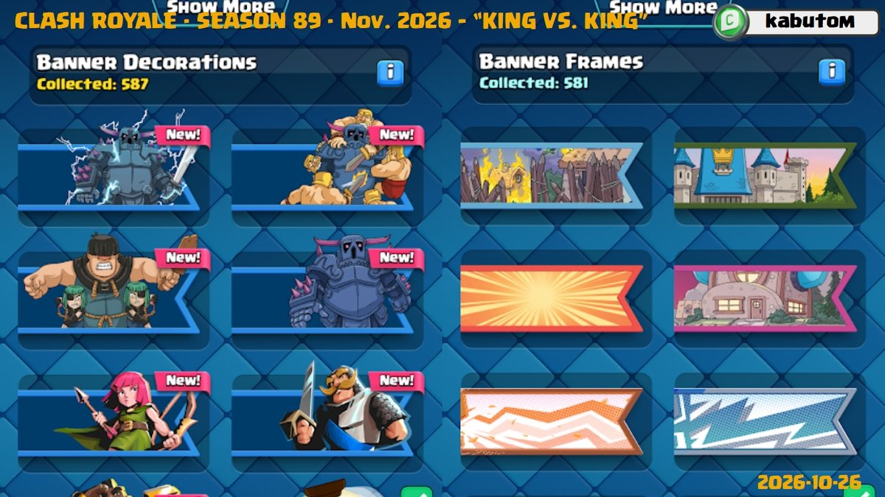

四套冲突之书战旗编号为 1、2、3、4，来自活动。全名竞技普通款来自免费令牌，其第一、第二和第三名三款对应 Crown Series。亲吻奖杯在皇室 tv 中已发放，觉醒镜像可从赛季商店中兑换。

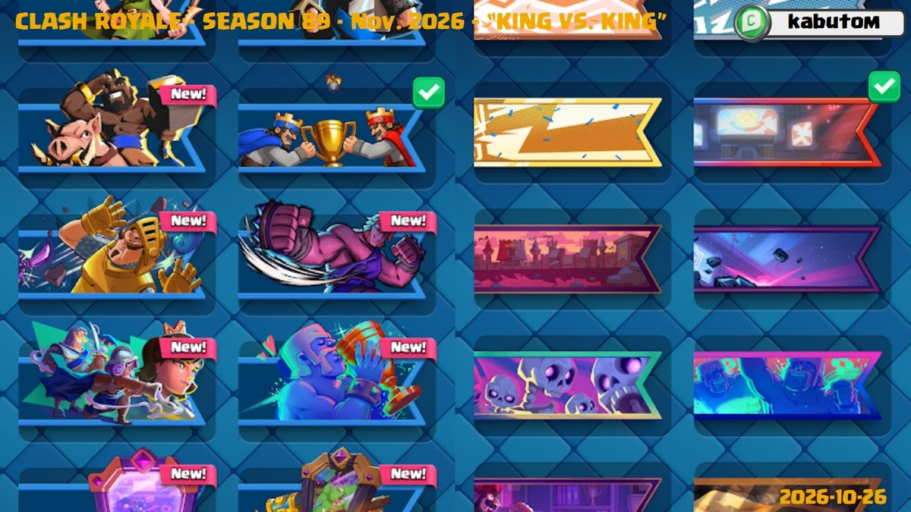

其余八套的渠道尚待公布。

- 王子猛击（Prince Smash）。
- 觉醒巨人出击（Evo Giant Strike）。
- 勇者战队（Valiant Team）。
- 国王粉丝（The Fan King）。
- 宝贝长大了（Baby’ll Grow Up）。
- 常青战队（Evergreen Team）。
- 为冠军而战（Fight for the Title）。
- 赢家（Winner）。

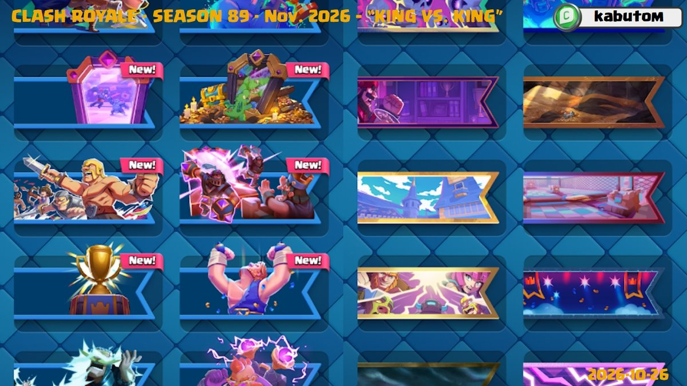

战旗素材提前公开不等于本月全部发放，渠道待定的战旗需要等待后续安排。

## 13 款表情

本季表情围绕觉醒巨人、觉醒镜像、哥布林和竞技主题展开。下表为内容说明，正式中文名与开放条件以游戏内为准。

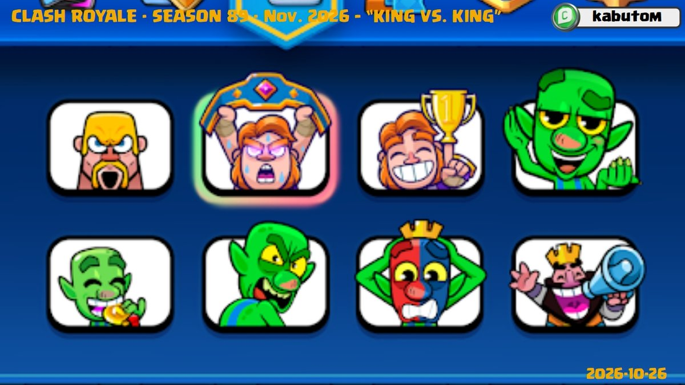

| 表情 | 获取 |
| --- | --- |
| 野蛮人 SIUUU | 赛季商店 |
| 进化巨人腰带 | 皇室通行证 |
| 进化巨人转奖杯 | 商店 |
| 进化镜像碎自我 | 商店 |
| 哥布林听不见 | 挑战 |
| 国王 GG 鼓掌 | 挑战 |
| 哥布林咬奖牌 | 排位赛 |
| 哥布林我的宝贝 | 社区活动 |
| 国王的宝物 | 社区活动 |
| 哥布林投降 | CRL 世界总决赛 |
| 国王振作 | 待公布 |
| 迷你皮卡电影院 | 待公布 |
| 进化镜像许愿胜利 | 待公布 |

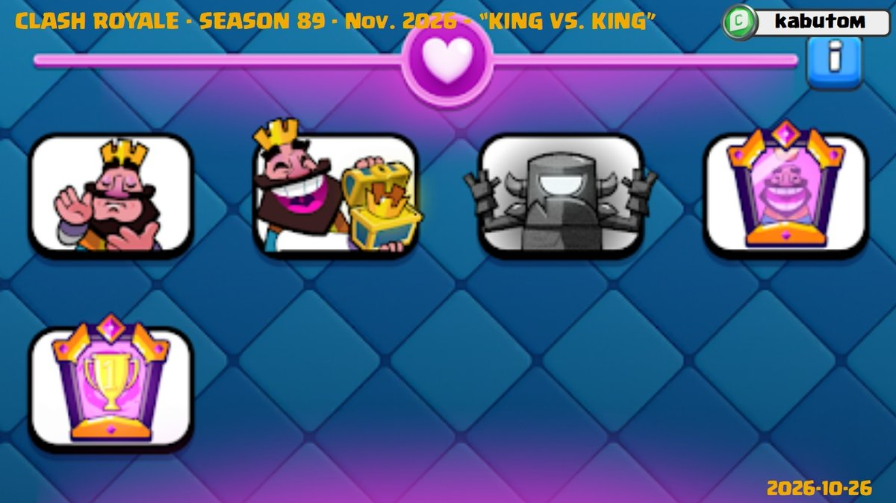

“哥布林我的宝贝”和“国王的宝物”对应“别关灯”社区活动。具体目标与发放条件尚待活动说明，渠道未公布的三款表情也不能直接计入本月免费奖励。

## 活动日历

| 时间 | 内容 |
| --- | --- |
| 11 月 2 日 | 赛季开启，觉醒巨人上线 |
| 11 月 2 日 - 8 日 | 每日谜题 第一批 |
| 11 月 4 日 - 8 日 | CRL 赛事平台活动 |
| 11 月 6 日 - 8 日 | CRL 世界总决赛，上海 |
| 11 月 9 日 | 赛季商店开放，镜像觉醒进入活动获取渠道 |
| 11 月 9 日所在周 | 卡组向导开始分批测试 |
| 11 月 9 日 - 12 月 7 日 | 卡牌之王主线，核心卡精通里程碑 |
| 11 月 16 日 - 23 日 | 机智挑战 |
| 11 月 23 日 - 30 日 | 强攻挑战 |
| 11 月 30 日 - 12 月 7 日 | 攻城消耗挑战，每日谜题 第二批 |
| 12 月 7 日 | 赛季结束，通行证与皇家市场关闭 |

以上为当前公布的日程，具体开放和截止时刻以游戏内倒计时为准。赛季结束不影响已解锁的觉醒卡牌。

## 新竞技场与加载画面

新竞技场延续红蓝双方对阵与年度赛事主题。

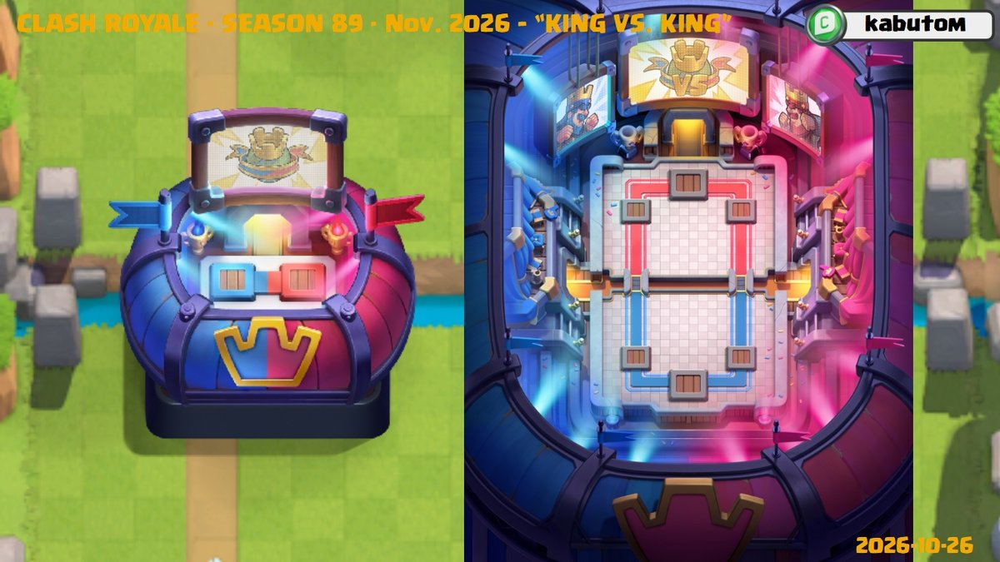

加载画面集合了本季及现有卡牌角色。

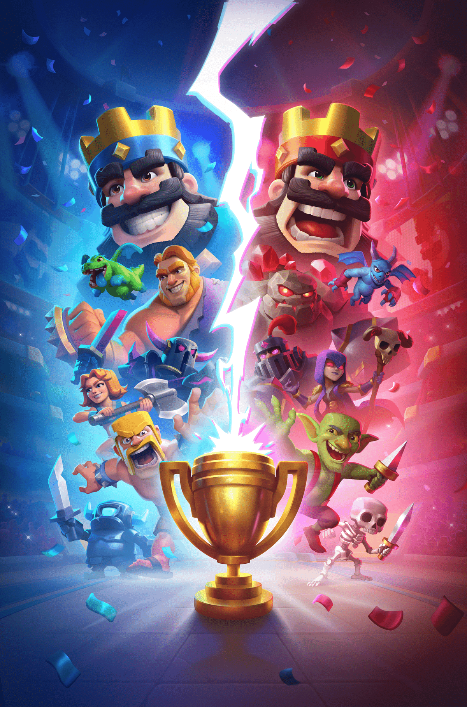

## 平衡调整

十一月的平衡调整已提前至 **10 月 19 日**实施，赛季开始时不再安排常规调整，以减少对全球总决赛备战的影响。

赛事结束后，如有需要仍可能追加调整，不能据此保证整个月环境都不会变化。

## 老问题修复

- 超级骑士跳跃期间不再免疫觉醒猎人的网。
- 觉醒超级骑士攻击时不再免疫龙卷风。
- 幻影刺客冲向进化法师的护盾时不再被击退。
- 进化工程炸弹人被渔夫拉扯时也能正常触发死亡伤害。
- 进化野蛮人攻城槌回退蓄力时，可以被电击一类的效果打断。
- 精英冰法在弹道命中前被击杀，会退还圣水。

