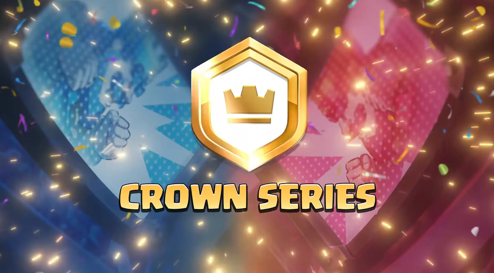
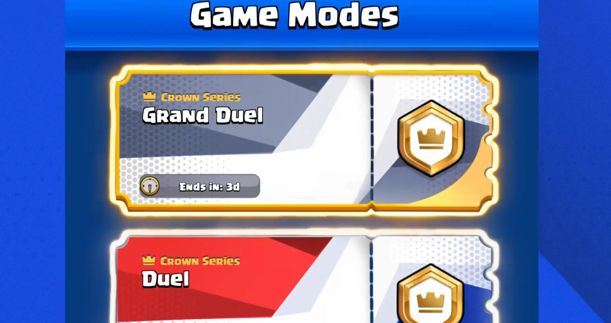
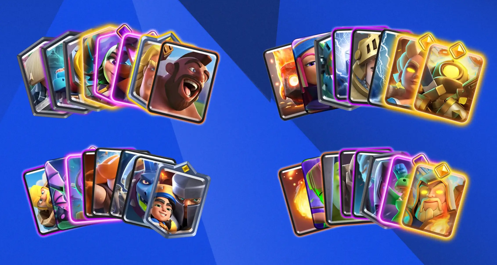
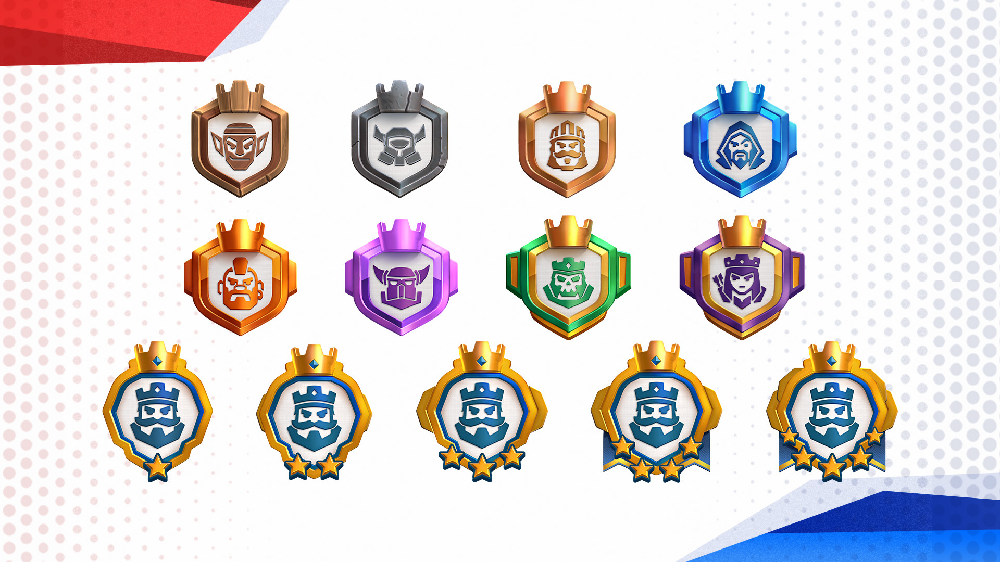
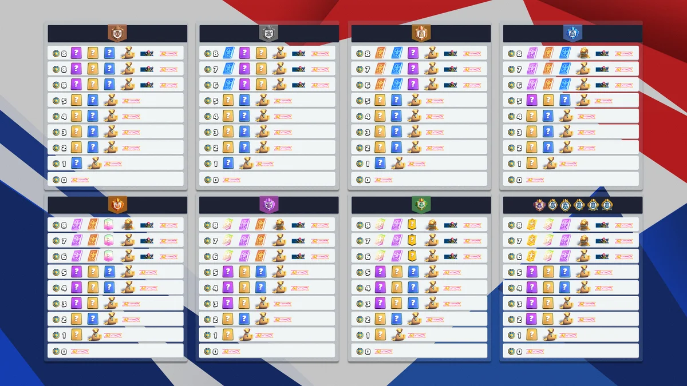
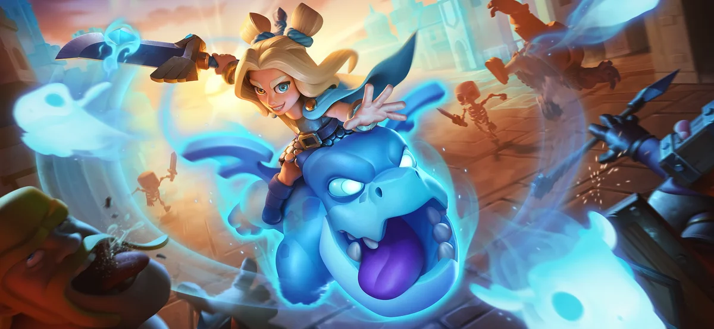

11月13日，明天，皇室战争上线新的竞技模式皇冠系列。

这是 Supercell 在本月 CRL 全球总决赛现场公布的内容之一，也是这套运营了十年的产品在竞技结构上少见的一次底层调整。

它和现有玩法的差别在于规则设计——天梯是一套卡组打通一个赛季，挑战赛是一次次重开，皇冠系列要求玩家在参赛前准备好三到四副互不重复的卡组，然后在同一个周末里与对手完成三局两胜的决斗。对局不仅仅考验单套卡组的熟练度，考验的更是卡组池的厚度与临场分配。

这一改动的意图不难读。皇室战争近两年的核心矛盾是单套卡组的天花板过高，主流卡组的对局高度程式化，玩家只要把一套牌练到极致，就能覆盖绝大多数场景。皇冠系列用「卡牌不能跨卡组重复」这条硬规则，把玩家的收藏从堆等级推向铺广度。

## 01 参赛门槛与联赛定位

参赛条件是 17 竞技场和 6000 杯，属于中后期玩家的门槛，不覆盖纯新手阶段。

玩家首次进入时，系统会根据三项数据估算水平并分配联赛，分别是奖杯之路进度、天梯与终极冠军的历史最高成绩，以及此前的皇冠系列决斗表现。首次参赛没有第三项数据，按前两项估算。每个赛事开始前可以升联赛，新赛季开始时重新计算，成绩上下浮动都会反映到初始联赛。

这套定级逻辑与天梯的赛季重置属于同一思路，用历史成绩压缩匹配成本，让新模式的初始对局不至于出现大范围实力错配。

## 02 决斗卡组，规则层面的核心改动

皇冠系列所有对局使用决斗卡组，赛制为三局两胜，双方用预先构建的卡组池轮流对战，先取得两场胜利者拿下该局。

卡组规则是全模式最关键的设计。一套完整决斗卡组由 4 副牌构成，每副 8 张卡，所有卡组之间不允许出现重复卡牌。凑满四副需要 32 张互不相同的卡，只准备三副也可参赛，需要 24 张不重复的卡。

少一副的代价体现在对抗的灵活性上。三副牌意味着对手只要准确判断出你缺少的那一副，可用空间就被压缩一部分；四副牌在对局顺序与克制关系上有更多调度余地。

等级规则容易产生误解。皇冠系列直接使用玩家收藏中的卡牌实际等级，联赛上限只起封顶作用，不会把低等级卡统一提升到上限。低等级卡在高联赛中依然是低等级，备战时需要按自身收藏水平排序，优先把主力卡组推至上限。

配套工具是更新后的组卡器。新版工具会基于玩家已有收藏给出方案，支持指定核心卡围绕构建，并会排除其他几副牌中已经使用的卡，规避重复。对于首次构建决斗卡组的玩家，这类工具能显著降低试错成本。

## 03 十三个联赛的分层逻辑

皇冠系列共设 13 个联赛，前 8 个为独立联赛，第 9 至 13 合并为国王联赛。

| 联赛     | 名称   | 卡牌等级上限 |
| ------ | ---- | ------ |
| 1      | 匕首   | 11     |
| 2      | 煎饼   | 11     |
| 3      | 胡子   | 12     |
| 4      | 魔法   | 12     |
| 5      | 锤子   | 13     |
| 6      | 盔甲   | 13     |
| 7      | 幽灵   | 14     |
| 8      | 女王   | 15     |
| 9 至 13 | 国王联赛 | 16     |

等级上限从 11 级起步，每两个联赛提一档，到国王联赛放开至 16 级。这条曲线与新模式的用户分层意图一致，低联赛用封顶抹平收藏差距，让构筑与操作成为主要变量，高联赛则把收藏深度重新纳入竞争力。

国王联赛内部还有一条匹配规则。普通决斗周末期间，9 至 13 联赛的玩家可能互相匹配，9 联赛的玩家会遭遇 13 联赛的对手。总决赛周末不适用该规则，按各自联赛独立结算。这条设计让国王联赛在常规赛段保持足够大的对局池，同时把顶级区间的对抗强度留给总决赛。

## 04 赛程结构与两种赛制

每个赛事持续 72 小时，按北京时间计算，从周五下午 5 点开始至周一下午 5 点结束。

赛季长度决定赛事数量。四周赛季为两次常规决斗加一次总决赛再加一个休整周，五周赛季为三次常规决斗加一次总决赛再加休整周。折算下来，每月通常有两到三场常规决斗，间隔较短，节奏接近周末活动而非长线赛季。

常规决斗周末的规则是取得 8 场胜利，累计 3 场失败即结束。奖励统一在本轮结束后一次性结算，赢满八场或输满三场都算结束，胜场数决定结算档位。

总决赛分两种赛制。第 1 至 8 联赛沿用淘汰式结构，目标 12 胜，失败上限放宽至 4 场。国王联赛改为积分排名制，最多进行 20 场，不因失败次数提前终止。由于胜场存在上限，同分情况普遍，排名依次比较四条指标，先看败场数量，再看决斗中赢下的单局净胜数，然后看击败对手的强度，最后看达到最终分数的时间先后。

总决赛奖励延后发放，赛事结束后的数日内到账。

## 05 奖励结构与激励梯度

奖励由联赛层级与胜场数共同决定，内容涵盖随机卡牌、万能卡、金币与旗帜外观。

外观部分全联赛统一。6 胜以上获得完整旗帜，5 胜及以下为旗帜底纹，0 胜同样有底纹。

八胜满档的奖励对照如下。

| 联赛 | 八胜奖励                                   |
| -- | -------------------------------------- |
| 匕首 | 8 张随机史诗、80 张随机稀有、200 张随机普通、4800 金币     |
| 煎饼 | 400 张普通万能、12 张随机史诗、100 张随机稀有、10000 金币  |
| 胡子 | 100 张稀有万能、800 张普通万能、16 张随机史诗、20000 金币  |
| 魔法 | 16 张史诗万能、140 张稀有万能、1200 张普通万能、28000 金币 |
| 锤子 | 20 张史诗万能、260 张稀有万能、4 张随机传奇、30000 金币    |
| 盔甲 | 4 张传奇万能、40 张史诗万能、280 张稀有万能、40000 金币    |
| 幽灵 | 4 张传奇万能、60 张史诗万能、4 张随机冠军、44000 金币      |
| 女王 | 4 张冠军万能、4 张传奇万能、80 张史诗万能、60000 金币      |
| 国王 | 8 张冠军万能、8 张传奇万能、100 张史诗万能、120000 金币    |

从数值分布看，联赛之间的落差远大于胜场之间的落差。匕首联赛八胜约 4800 金币，国王联赛同样八胜为 12 万，相差二十余倍。金币与万能卡的投放明显向高联赛倾斜，奖励结构承担了推动玩家向上流动的功能。

总决赛的完整奖励表尚未公布。已确认的部分是，国王联赛排名足够高的玩家可在常规奖励之外获得一张皇室通行证，通过 Supercell ID 发放，激活时间由玩家自行决定。把付费通行证作为高段位竞技奖励，属于皇室战争此前较少采用的激励方式。

## 06 设计意图与潜在变量

从公开信息看，皇冠系列解决的是三个具体问题。

第一是竞技内容的填充。皇室战争此前的高强度竞技入口主要依赖天梯与不定期挑战赛，前者周期长、后者碎片化，缺少一个介于两者之间、按周结算的中频赛事。72 小时的周末赛制正好补上这一段。

第二是收藏价值的重新定价。卡牌等级在单套卡组体系里只影响一套牌的强度，在决斗卡组体系里则决定玩家能构建几套可用方案。32 张不重复卡牌的要求，直接抬高了收藏广度的重要性。

第三是竞技层级的细分。13 个联赛加国王联赛排行榜，把原本集中在天梯前段的竞技人群重新切分，给不同水平段都留出了可竞争的区间。

潜在变量同样存在。三到四副卡组的准备成本对休闲玩家偏高，收藏较浅的玩家可能长期停留在联赛前四档，难以体验完整模式。国王联赛 20 场积分制的时间投入不低，一个周末打完 20 场 BO3 对部分玩家存在实际压力。低联赛的等级封顶虽然降低了门槛，但也可能让高收藏玩家在新模式早期缺少优势感，影响参与意愿。

这些问题能否在首个赛季的运营数据中得到缓解，取决于官方是否调整联赛数量、等级上限与赛事密度。官方已表示会根据玩家反馈持续迭代该模式。

## 结语

皇冠系列的意义不止于一个新玩法。它把皇室战争长期以来的单卡组竞技逻辑，改成了围绕卡组池的博弈，同时用联赛分层与奖励梯度重新组织了竞技人群。这套结构能否成立，要看第一个赛季的实际参与率和留存表现。

对玩家而言，短期最实际的动作是扩充卡组池，把三到四副不重复的卡组提前准备好。模式的规则细节在首轮周末后可能还有微调，届时值得再观察一次。

如果内容对您有帮助，欢迎在游戏内绑定创作者代码 xiaomi。感谢阅读，我们下期再见。
