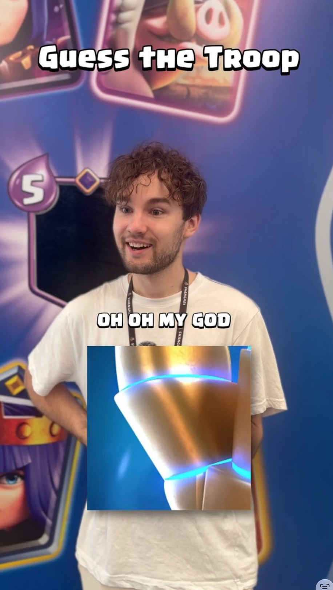
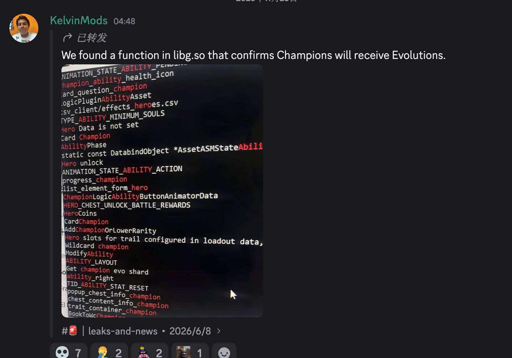
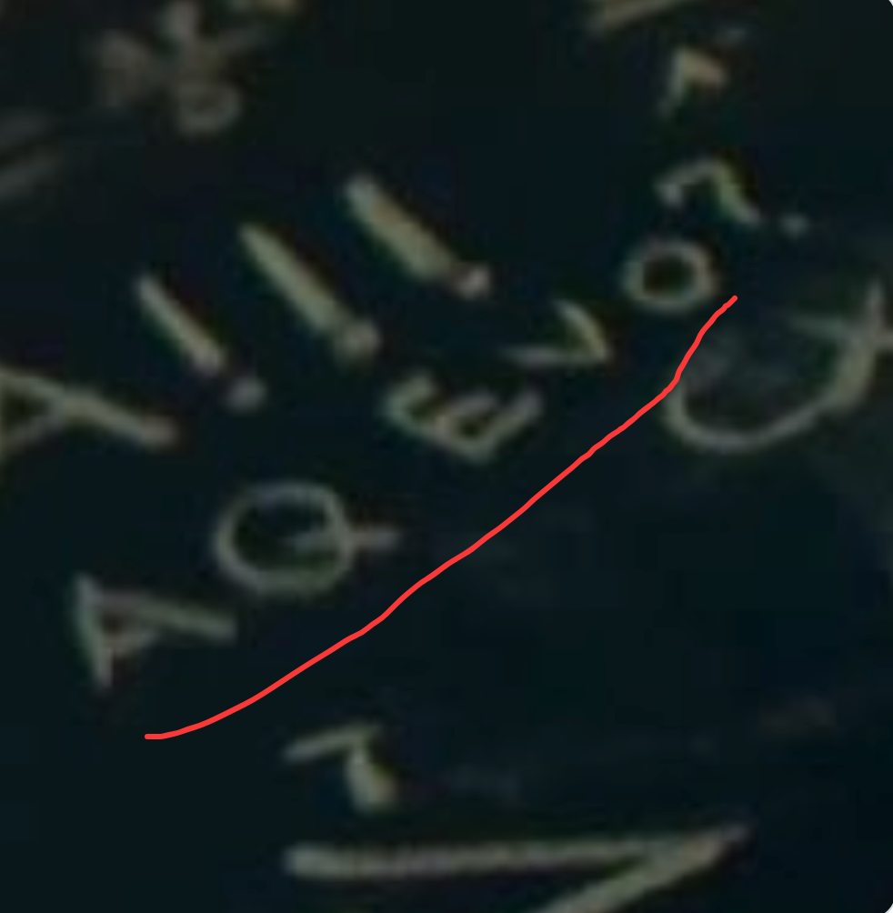
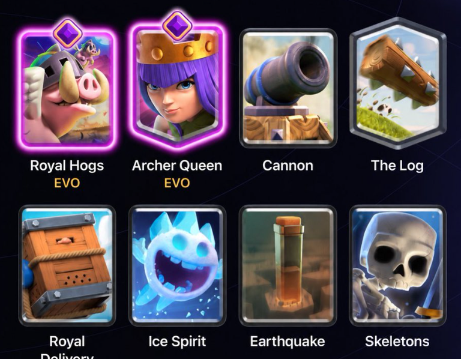

最近皇室战争官方发了一段根据局部画面猜卡牌的视频，不过，玩家的注意力很快就从题目转到了背景板上。

**弓箭女皇、5 费卡框，再加上一枚觉醒菱形标记。**

这几个元素出现在同一个画面里，确实很难让人不往“觉醒女皇”上想。女皇是不是也要有觉醒形态了？

一起先看看这些线索。

## 猜卡牌的视频

先看这张完整截图。

背景左下方能看到弓箭女皇，上方则是一张没有显示卡面的 5 费卡框。卡框顶部带着紫色菱形标记，但是整体卡牌的轮廓分明就是英雄卡！

弓箭女皇本身就是 5 费，把她和这张特殊卡框联系起来，再自然也不过了。

不过，**这两处图案虽然同时出现在背景里，画面并没有直接把女皇放进那张卡牌框中。** 然而考虑到 SC 一贯喜欢当谜语人的尿性，英雄卡要觉醒了，这个猜测看来也并非空穴来风。

**英雄卡牌，是否终于也要加入觉醒系统？**

## 其他旧线索

还有另一张截图，这是来自于玩家社区。发帖者声称在客户端的 `libg` 中找到了相关内容，画面里能看到一条很显眼的字符串。

`Get champion evo shard`

按字面理解，它与“获取英雄觉醒碎片”有关。

但这张图发的时间就早了，是 **2026 年 6 月 8 日**，属于这次被重新翻出的旧线索。单凭这些文字和截图，倒也不能判断它对应的是已完成的功能、测试内容，还是提前留下的接口。

另外，在上一期皇室 TV 的背景中其实也出现了类似的线索。

把这些东西拿到一起看，似乎也更加佐证了“英雄觉醒”的可能性。

## 玩家已经开始讨论槽位怎么放了

在玩家社区中，大家讨论最多的，除了英雄觉醒之外，还进一步提出了槽位问题。

假如英雄真的获得觉醒形态，组卡时该怎样选择？

是把卡放进支持觉醒的槽位，就能同时使用原有技能与觉醒能力？

还是需要在两种形态之间作出取舍？

这些问题会直接影响卡组构筑。女皇原本就有技能，如果再增加觉醒机制，玩家关心的当然不只是卡面换个颜色，还包括技能如何保留、觉醒怎样循环，以及一局里能触发几次。

**如果女皇真的拿到觉醒，你更希望加强她的普通攻击，还是围绕隐身技能做变化？**
