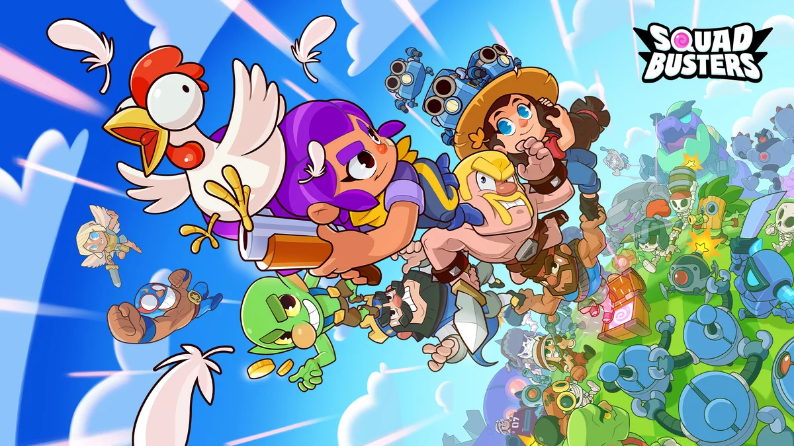
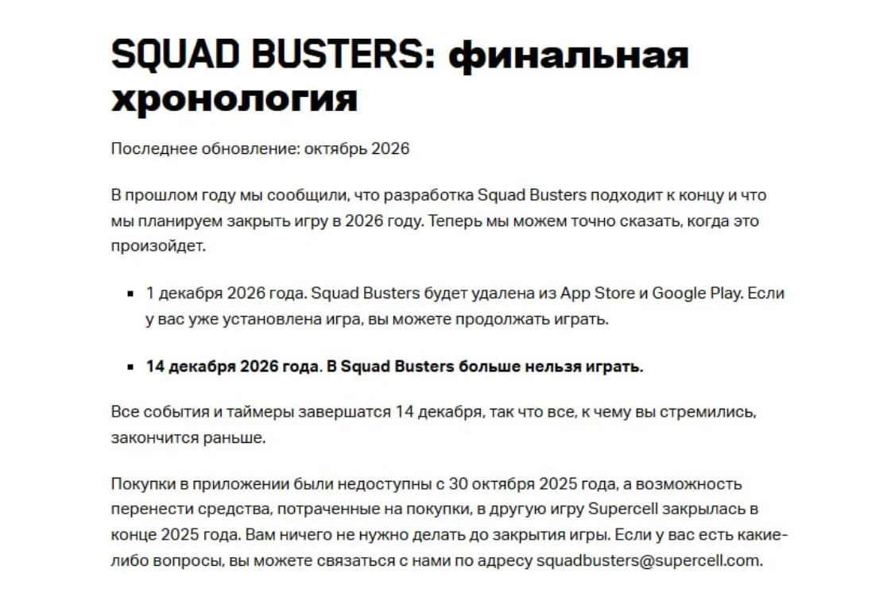
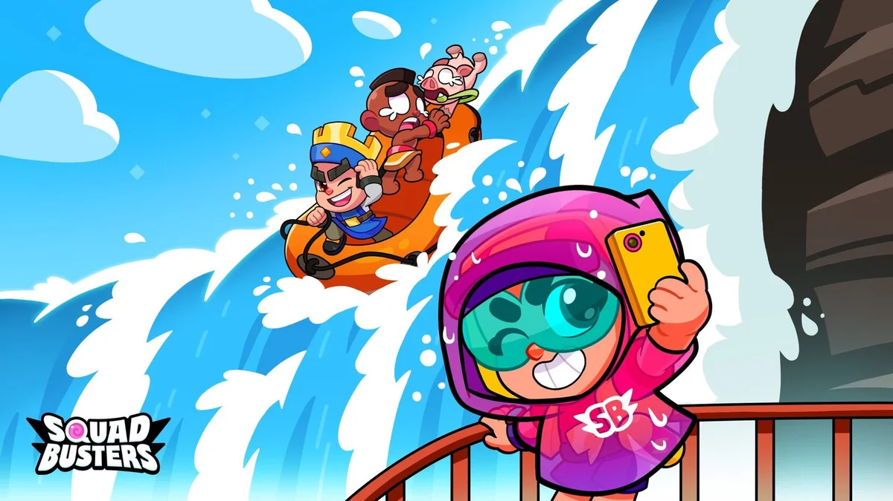
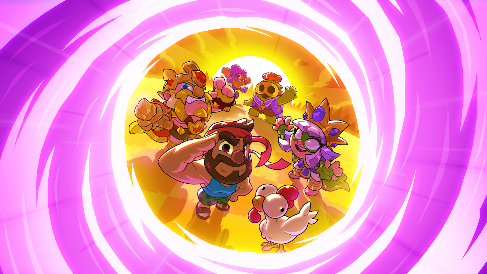

**两年六个月又十五天。** 这将是 Supercell 旗下《爆裂小队》（Squad Busters）从全球上线到正式关服的全部运营时间。

2024 年 5 月 29 日，来自几款 Supercell 游戏的熟悉角色，在这款新游戏里组成了小队。到了 **2026 年 12 月 14 日**，这场跨越不同游戏世界的聚会将正式结束。

10 月 14 日，Supercell 官方页面更新了爆裂小队的公告，将此前“2026 年中后期关闭服务器”的计划落实为具体日期。

游戏将分两个阶段结束服务。

- **12 月 1 日**，游戏从 App Store 和 Google Play 下架。已经安装的玩家仍然可以继续游玩。
- **12 月 14 日**，游戏停止游玩，所有活动和计时器也会在这一天结束。

此次公布的是最终关服安排。Supercell 已在 2025 年宣布停止开发《爆裂小队》，此后服务器继续运行，为玩家保留了一段游玩时间。

## 一次超级细胞角色大集结

《爆裂小队》的主要特色，是将 Supercell 多款游戏中的角色带入同一场比赛。

野蛮人、雪莉和《卡通农场》中的角色，可以跨越各自所属的游戏世界，组成一支小队。这种跨作品角色组合，让《部落冲突》《荒野乱斗》《皇室战争》等游戏的玩家有机会在新的玩法中使用熟悉的角色。

游戏全球上线时，官方将其定位为十人参与的派对动作游戏。玩家在对局中逐渐壮大小队，一边处理地图上的目标，一边与其他玩家争夺资源。角色搭配与临场选择构成了游戏的主要体验。

**2024 年 5 月 29 日，《爆裂小队》正式全球上线。** 根据当时的官方公告，游戏在五周内获得了 4000 万次预约。

从那一天算到今年 12 月关服，这款游戏的全球运营时间约为两年半。

## 全球上线后的长期留存问题

Supercell 在年度复盘中回顾了《爆裂小队》的开发与测试过程。

项目从 2020 年开始开发，2023 年先后进行了两轮封闭测试。第一轮表现没有达到目标，团队修改玩法后，第二轮测试的数据有所改善。这些结果给了他们继续推进的信心。

但全球上线之后，玩家的行为和留存没有重现封闭测试中的表现。

公司在复盘中承认，当时的测试主要验证了核心玩法和七日留存，软启动又只有一个月，无法充分判断长期留存和付费表现。团队认为，如果当时再进行一次时间更长的测试，或许能更早发现游戏与玩家期待之间的差距。

这份复盘指出了发行表现与长期运营之间的差距。预约和下载反映了玩家的初始兴趣，长期留存则取决于核心玩法能否持续满足玩家期待。《爆裂小队》全球上线后的表现，没有达到团队此前根据测试结果形成的预期。

## 英雄改版未能明确后续方向

开发团队尝试过多次调整，其中规模较大的一次是加入英雄系统的改版。官方 FAQ 解释，这轮重做涉及移动、寻路和目标选择，融合、宝箱、法术与经济系统也一起发生了变化。英雄更新回应了部分玩家希望在对局中拥有更多控制权的反馈。

根据团队的说明，改版之后，玩家对游戏方向仍有不同期待。部分玩家更喜欢初版的简单体验，另一些玩家希望操作和决策更加丰富，团队未能找到兼顾这些需求且足以支撑长期发展的方案。

按照团队的判断，要继续做下去，就需要再来一次大幅转向。改动规模可能接近重新做一款游戏，还会再次改变已经喜欢现有版本的玩家的体验。

回到初版也很困难。许多系统已经重写，恢复旧版本需要重建，而团队此前已经判断，初版无法支撑长期发展。

因此，团队在 2025 年宣布停止开发。今年更新的时间表，进一步明确了游戏下架与停止服务的日期。

Supercell 表示，经过多次重做后，团队仍未看到将游戏提升至公司预期水平的明确路径。再次大幅改版会改变现有玩家的体验，也无法保证吸引并留住新玩家，这成为停止开发的重要原因。

## 关服前的账号与付费事项

关服时间确定后，仍在游玩的玩家需要关注游戏安装、账号资料和付费处理的期限。

12 月 1 日下架后，已经安装的游戏还能继续玩到 12 月 14 日。如果打算在最后几周回去看看，可以提前确认设备上保留了游戏。

服务器关闭后，游戏没有离线模式，官方也不提供私服延续方案。玩家资料和统计将无法再访问。官方建议，希望保留账号资料与游戏回忆的玩家，在关服前保存截图或视频。

截至目前，Supercell 没有公布《爆裂小队》的回归计划。游戏将继续运行至 12 月 14 日，玩家可在此之前参与现有对局与活动。如对关服安排有疑问，可通过官方公布的邮箱 squadbusters@supercell.com 联系团队。

## 那些曾经“开香槟”的游戏

在 Supercell 的公司文化里，失败也可以开香槟。公司曾多次公开提到这个传统，用来鼓励团队承担风险，并分享项目没有成功的经验。玩家后来也常用“开香槟”来指代新游戏被取消或关服。

下面盘点的是截至 2026 年 10 月，公开资料中能确认名称、已经取消开发或宣布停止运营的自研项目。

- **Gunshine.net / Zombies Online**

  Supercell 早期的浏览器多人 RPG，2011 年决定停止开发，2012 年关服。此后，公司将开发重心转向移动游戏。

- **Magic**

  面向 Facebook 的项目，2011 年取消。原团队后来开发了《部落冲突》，后者也曾使用 Magic 这个代号。

- **Pets vs. Orcs**

  围绕宠物与兽人战斗展开的早期移动游戏，2012 年取消。

- **Tower**

  2012 年取消的内部项目，只公开过代号，详细玩法未披露。

- **Battle Buddies**

  小队战术射击游戏，未走出测试阶段，2012 年取消。

- **Spooky Pop**

  2014 年开始有限地区测试的消除类游戏，2015 年结束。

- **Smash Land**

  玩家通过弹射角色攻击敌人，项目在 2015 年结束。部分开发人员后来加入《皇室战争》团队。

- **Rush Wars**

  以建造防守、组队进攻为核心的策略游戏，公开测试约三个月，于 2019 年关服。

- **Hay Day Pop**

  将农场建设与消除关卡结合的《卡通农场》衍生游戏，2020 年宣布停更，2021 年关服。

- **Clash Quest**

  Clash 世界观下的回合制战术游戏，曾进行区域测试和大幅改版，2022 年结束。

- **Everdale**

  以合作建设村庄为主的游戏，2022 年关服。项目后来交由 Metacore 接手，该工作室也在 2024 年停止开发。

- **Floodrush**

  八人参与的岛屿战斗与部队收集游戏，公开测试时间很短，2023 年取消。

- **Clash Mini**

  以迷你角色布阵、自动战斗为核心，2024 年结束。部分创意后来进入《皇室战争》的皇室战棋。

- **Clash Heroes**

  Clash 世界观下的动作游戏，原项目在 2024 年结束。部分美术与素材用于另一个项目 Project R.I.S.E，后者采用重新开发的玩法。

- **Squad Busters / 爆裂小队**

  集合多个 Supercell 游戏角色的派对动作游戏，2025 年停止开发，将于 2026 年 12 月 14 日关服。它也是公司首次在全球上线后宣布终止的游戏。

还有一款经常出现在这类名单中的游戏，需要单独列出。

- **Boom Beach Frontlines**

  采用《海岛奇兵》世界观，由 Space Ape Games 开发的团队射击游戏，属于合作项目。2022 年停止开发，2023 年关服。

这份名单仍然无法覆盖所有内部原型。Supercell 在 2023 年就曾披露，已经终止了三十多个游戏项目，其中许多从未向玩家公开。

有些名字只停留在公告里，有些曾经在玩家手机上留下一个图标。Clash Mini 的棋盘、Everdale 的村庄，以及《爆裂小队》里那些临时组成的队伍，都曾让一部分玩家愿意每天回来。项目终止之后，有些创意还能在新游戏里延续；玩家原来的存档和那段游玩经历，则很难一起搬过去。

《爆裂小队》还有最后两个月。关服前保存的几张截图，或许就是这支小队此后最完整的留念。

